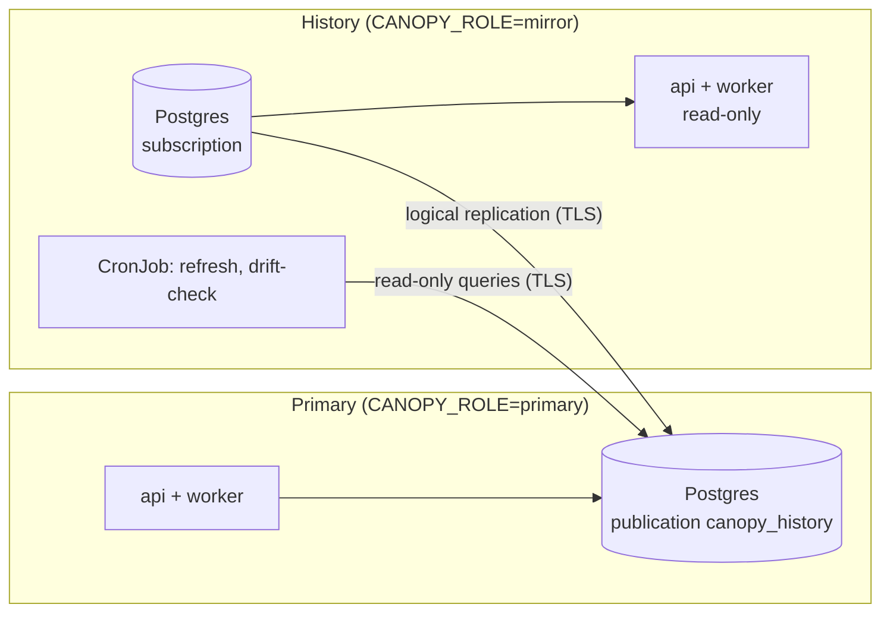

# History mirror

A history mirror is a read-only copy of one Canopy instance's database, kept in step
by Postgres logical replication. Remote users browse the full history there while the
primary goes on controlling the machine, and the mirror is the off-site copy of the
data. Each instance has its own mirror; nothing is shared between instances.

The commands below are `python -m canopy.core.replication <command>`, run from the
Canopy image with the instance's `CANOPY_DATABASE_URL`, `CANOPY_ROLE` and
`CANOPY_INSTANCE`. Every command refuses to run on the wrong side.

## Topology



- **One connection direction.** Every connection opens from the mirror's side to the
  primary's Postgres: the subscription (as the replication role) and the drift check
  and re-seed (as the reader role). The primary never connects to the mirror.
- **What replicates.** `canopy.core.replication.registry` classifies every table.
  Reference tables (PVs, tags, configs) and time-series tables (snapshots and their
  values) replicate with inserts, updates and deletes. Local tables never replicate:
  each side mints and checks its own API keys. `TRUNCATE` isn't published, so one
  typed on the primary by hand doesn't empty history.
- **Schema.** Both sides run the same Alembic tree. A few migration steps run on one
  side only (see "Database Migrations" in `CONTRIBUTING.md`).

## Roles

### Instance roles

| `CANOPY_ROLE` | Writes | Worker |
|---|---|---|
| `primary` (default) | Everything, including machine operations | All tasks |
| `mirror` | Refused with 403 `read_only_instance`, except API-key management | Stateless tasks only |

`GET /v1/instance` reports the role, so clients can hide write controls, and the
Alembic head shipped in the image, which the deploy check below compares.

### Database roles

| Role | Database | Used by | Rights |
|---|---|---|---|
| `replicator` | primary | The mirror's subscription | `REPLICATION LOGIN`; `publish` grants `SELECT` on the published tables only |
| `canopy_reader` | primary | `drift-check`, `reseed` | `LOGIN`; `publish` grants the same `SELECT`. It can't read API-key hashes |
| table owner (e.g. `canopy_owner`) | mirror | Migrations, `grants`, `refresh`, `subscribe` | Owns the tables; member of `pg_create_subscription` |
| `canopy_app` | mirror | The mirror's API and worker | `grants` gives `SELECT` on replicated tables and read-write on API keys |
| superuser | mirror | `reseed` | Or the table owner with `EXECUTE` on `pg_replication_origin_advance(text, pg_lsn)` |

The names are the defaults of `CANOPY_REPLICATION__REPLICATOR_ROLE`, `__READER_ROLE`
and `__APP_ROLE`. The primary's `pg_hba.conf` admits `replicator` and
`canopy_reader` over `hostssl` with SCRAM from the mirror's network only.

The primary's Postgres needs `wal_level = logical`, enough `max_replication_slots`
and `max_wal_senders`, and `max_slot_wal_keep_size` set **before the first slot
exists**: without a cap, a mirror that stops consuming makes the primary keep WAL
until its disk is full.

## Release order

The mirror always migrates first, so it never lacks a column or table the primary
sends.

1. **Mirror**: `alembic upgrade head` (with `CANOPY_ROLE=mirror`), then `grants`, then
   `refresh`, as the table owner. Then roll out the mirror's API and worker.
2. **Primary**: `alembic upgrade head`, then `publish`. Then roll out its API and worker.
3. The mirror's next hourly `refresh` copies any table first published in step 2.

A deploy pipeline can enforce the order: before step 2, compare `alembicHead` from the
mirror's `GET /v1/instance` with the head in the new image, and stop if the mirror is
behind.

**First deployment.** Run `publish` on the primary, migrate the mirror and run
`grants`, then run `subscribe` once, with `CANOPY_REPLICATION__PUBLISHER_DSN` from a
secret. It copies every published table, then streams changes. `status` shows the copy's
progress on either side.

## Operations

### CronJobs

On the mirror, hourly: `refresh`, then `drift-check` (with
`CANOPY_REPLICATION__READER_DSN`). `drift-check` exits 1 when the copy has drifted
and 2 when it couldn't check, so either fails the Job.

### Metrics and alerts

Each side's `/metrics` reports its half of replication: the primary's slots, and the
mirror's subscription. `/health/ready` checks the database. The gauges, and the alert
rules shipped in `docker/observability`, are listed under
[Replication](../observability/metrics.md#replication). The lag to watch is the
primary's `canopy_replication_slot_lag_bytes`; a mirror can't measure its own.

### Drift check

Replication skips an update or delete whose row the mirror doesn't have, without an
error, so the copy can drift with every gauge green. `drift-check` compares each
table the subscription holds:

- reference tables: row count and a hash of all rows;
- time-series tables: row counts per UTC day (snapshot values by their snapshot's
  day), plus values whose snapshot is missing.

Tables that differ are read again after `--settle` seconds (30 by default), so lag
isn't reported as drift. The JSON report names each drifting table and day. To repair
drift, find its cause, then run `reseed` with `--since` no later than the oldest
drifting day (reference tables are always reconciled in full).

## Runbooks

Run SQL on the mirror as its superuser, from the history cluster's Postgres pod. The
subscription is `canopy_history_<instance>`.

### Slot lost

**Signs**: the primary's slot shows `wal_status = lost`, and the mirror's apply
worker logs that it can't start streaming. The primary dropped WAL the mirror still
needed, so this subscription can't continue.

1. On the mirror, detach and drop the subscription:
   ```sql
   ALTER SUBSCRIPTION canopy_history_<instance> DISABLE;
   ALTER SUBSCRIPTION canopy_history_<instance> SET (slot_name = NONE);
   DROP SUBSCRIPTION canopy_history_<instance>;
   ```
2. On the primary, drop the invalidated slot:
   `SELECT pg_drop_replication_slot('canopy_history_<instance>');`
3. On the mirror, find the newest snapshot it holds:
   `SELECT max(created_at) FROM squirrel.snapshot;`
4. Run `reseed --since <that time>` on the mirror, with both
   `CANOPY_REPLICATION__PUBLISHER_DSN` and `CANOPY_REPLICATION__READER_DSN` set. It
   creates the subscription disabled and without a copy, copies what changed since
   that time, and enables it from the cut. An earlier time is safe, only slower; a
   later one is refused, because its changes would be lost.
5. Run `drift-check`.

If a write transaction was open on the primary when the re-seed began (the report's
`open_at_cut` is above zero, and the log warns), it is both copied and replayed. If it
inserted rows, apply stops right after the re-seed with a duplicate key. The
transaction is already in place, so skip it with
`ALTER SUBSCRIPTION canopy_history_<instance> SKIP (lsn = '<lsn>')`, taking the LSN from
the "finished at" in the mirror's log.

### History PITR

When the mirror's database must be restored to an earlier point in time (corruption,
or a mistake made on the mirror itself):

1. Restore it to time *T*, starting the restored server with
   `max_logical_replication_workers = 0`. The restored subscription still points at the
   primary's slot, which is past *T*, and would otherwise resume from there and skip
   everything in between.
2. On the mirror, detach and drop the subscription (step 1 of "Slot lost"). On the
   primary, drop the old slot, which is still holding WAL.
3. Restart the mirror with its usual `max_logical_replication_workers`.
4. Run `reseed --since <T>` (or the newest snapshot the restored database holds, if
   that's earlier), then `drift-check`.

### Prod wipe or rebuild

Wiping or rebuilding the primary's database drops its publication and slot, and the
mirror's subscription starts failing. The mirror still holds everything up to the
wipe.

1. Rebuild the primary's data. The mirror is normally newer than the primary's last
   dump, so rebuild from it as in "Prod host lost" below. If you restore a dump
   instead, also copy the mirror's reference tables into the primary before step 3:
   `reseed` makes the mirror's reference tables match the primary's, and would delete
   whatever the dump lacks (and, through foreign keys, the snapshot values of a deleted PV).
2. On the primary: `alembic upgrade head`, then `publish`.
3. On the mirror: detach and drop the old subscription (step 1 of "Slot lost"), then run
   `reseed --since <time the rebuilt primary's data starts>` and `drift-check`.

### Prod host lost

Rebuild the primary from the mirror, which holds every replicated row. API keys are
local, so they come from the primary's latest dump or are minted again.

1. On the new host, create the database and run `alembic upgrade head`.
2. From the mirror, copy the reference tables (`pg_dump --data-only --table=...` for
   each reference table in the registry, restored with `psql`), then the time-series
   rows the primary should hold (all of them, or a recent window), parents before
   children (`\copy (SELECT ...) TO` on the mirror, `\copy ... FROM` on the primary).
3. Restore or mint API keys, then run `publish`.
4. On the mirror: detach and drop the old subscription, run
   `reseed --since <newest snapshot on the mirror>`, then `drift-check`.

### Bad update replicated

A bad write on the primary (a mass edit, a wrong delete) reaches the mirror within
seconds. Never repair it on the mirror; repair it on the primary and let replication
carry the fix.

1. Restore the mirror's backup into a scratch database at a time before the bad write.
2. Extract the good rows from it (`\copy (SELECT ...) TO`).
3. Write them back on the primary, in one transaction, parents before children.
4. Run `drift-check` on the mirror once replication has applied the fix.
