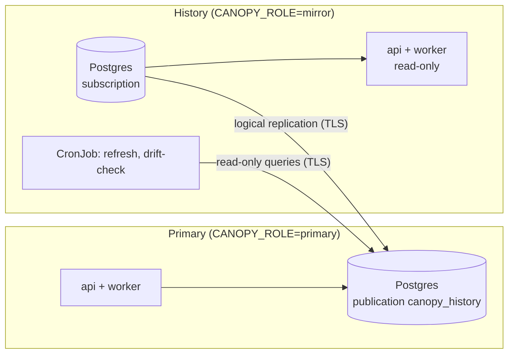

# History mirror

A history mirror is a read-only copy of one Canopy instance's database, kept in step
by Postgres logical replication. Remote users browse the full history there while the
primary goes on controlling the machine, and the mirror is the off-site copy of the
data. Each instance has its own mirror; nothing is shared between instances.

The commands below are `python -m canopy.core.replication <command>`, run from the
Canopy image with the instance's `CANOPY_DATABASE_URL`, `CANOPY_ROLE` and
`CANOPY_INSTANCE`. Every command refuses to run on the wrong side.

## Topology



- **One connection direction.** Every connection opens from the mirror's side to the
  primary's Postgres: the subscription (as the replication role) and the drift check
  and re-seed (as the reader role). The primary never connects to the mirror.
- **What replicates.** `canopy.core.replication.registry` classifies every table.
  Reference tables (PVs, tags, configs) and time-series tables (snapshots and their
  values) replicate with inserts, updates and deletes. Local tables never replicate:
  each side mints and checks its own API keys. `TRUNCATE` isn't published, so one
  typed on the primary by hand doesn't empty history.
- **Schema.** Both sides run the same Alembic tree. A few migration steps run on one
  side only (see "Database Migrations" in `CONTRIBUTING.md`).

## Roles

### Instance roles

| `CANOPY_ROLE` | Writes | Worker |
|---|---|---|
| `primary` (default) | Everything, including machine operations | All tasks |
| `mirror` | Refused with 403 `read_only_instance`, except API-key management | Stateless tasks only |
| `forward` | An allowlisted set sent to the primary ([Forward mode](#forward-mode)); the rest refused as on a mirror | Stateless tasks only |

`GET /v1/instance` reports the role, so clients can hide write controls, and the
Alembic head shipped in the image, which the deploy check below compares.

Define facilities on the primary only. `core.facility` replicates, so a mirror gets
them, and its facility routes refuse writes like any other. The facility scripts
write the database directly, so don't run them against a mirror.

### Database roles

| Role | Database | Used by | Rights |
|---|---|---|---|
| `replicator` | primary | The mirror's subscription | `REPLICATION LOGIN`; `publish` grants `SELECT` on the published tables only |
| `canopy_reader` | primary | `drift-check`, `reseed` | `LOGIN`; `publish` grants the same `SELECT`. It can't read API-key hashes |
| table owner (e.g. `canopy_owner`) | mirror | Migrations, `grants`, `refresh`, `subscribe` | Owns the tables; member of `pg_create_subscription` |
| `canopy_app` | mirror | The mirror's API and worker | `grants` gives `SELECT` on replicated tables and read-write on API keys |
| superuser | mirror | `reseed` | Or the table owner with `EXECUTE` on `pg_replication_origin_advance(text, pg_lsn)` |
| `canopy_heartbeat` | primary | The mirror's `heartbeat` and `switch` | `LOGIN`; `publish` lets it read and write `core.history_heartbeat` and nothing else. Only needed for [pruning](#prune) |

The names are the defaults of `CANOPY_REPLICATION__REPLICATOR_ROLE`, `__READER_ROLE`,
`__APP_ROLE` and `__HEARTBEAT_ROLE`. The primary's `pg_hba.conf` admits `replicator`,
`canopy_reader` and `canopy_heartbeat` over `hostssl` with SCRAM from the mirror's
network only.

The primary's Postgres needs `wal_level = logical`, enough `max_replication_slots`
and `max_wal_senders`, and `max_slot_wal_keep_size` set **before the first slot
exists**: without a cap, a mirror that stops consuming makes the primary keep WAL
until its disk is full.

## Release order

The mirror always migrates first, so it never lacks a column or table the primary
sends.

1. **Mirror**: `alembic upgrade head` (with `CANOPY_ROLE=mirror`), then `grants`, then
   `refresh`, as the table owner. Then roll out the mirror's API and worker.
2. **Primary**: `alembic upgrade head`, then `publish`. Then roll out its API and worker.
3. The mirror's next hourly `refresh` copies any table first published in step 2.

A deploy pipeline can enforce the order: before step 2, compare `alembicHead` from the
mirror's `GET /v1/instance` with the head in the new image, and stop if the mirror is
behind.

**First deployment.** Run `publish` on the primary, migrate the mirror and run
`grants`, then run `subscribe` once, with `CANOPY_REPLICATION__PUBLISHER_DSN` from a
secret. It copies every published table, then streams changes. `status` shows the copy's
progress on either side.

## Operations

### CronJobs

On the mirror, hourly: `refresh`, then `drift-check` (with
`CANOPY_REPLICATION__READER_DSN`). `drift-check` exits 1 when the copy has drifted
and 2 when it couldn't check, so either fails the Job. Where the primary prunes, the
Job also runs `heartbeat` last, as described under [Prune](#prune).

### Metrics and alerts

Each side's `/metrics` reports its half of replication: the primary's slots, and the
mirror's subscription. `/health/ready` checks the database. The gauges, and the alert
rules shipped in `docker/observability`, are listed under
[Replication](../observability/metrics.md#replication). The lag to watch is the
primary's `canopy_replication_slot_lag_bytes`; a mirror can't measure its own.

### Drift check

Replication skips an update or delete whose row the mirror doesn't have, without an
error, so the copy can drift with every gauge green. `drift-check` compares each
table the subscription holds:

- reference tables: row count and a hash of all rows;
- time-series tables: row counts per UTC day (snapshot values by their snapshot's
  day), plus values whose snapshot is missing.

Tables that differ are read again after `--settle` seconds (30 by default), so lag
isn't reported as drift. The JSON report names each drifting table and day. To repair
drift, find its cause, then run `reseed` with `--since` no later than the oldest
drifting day (reference tables are always reconciled in full).

## Prune

A primary whose disk can't hold all of its history keeps the last `CANOPY_WINDOW_DAYS`
days of snapshots and leaves older ones to its mirror. Turn this on only where the
sizing forecast says it's needed. It takes the three steps below, once, then a worker
setting. Prune deletes must never reach the mirror, so the primary first moves to a
second publication layout: `canopy_ref` carries the reference tables with every
operation, and `canopy_ts` carries the time-series tables with inserts and updates
only. User deletes still reach the mirror, because deleting a snapshot or a PV only
marks it deleted.

### Switch to the split layout

1. On the primary: `publish --split`. It creates `canopy_ref` and `canopy_ts` beside
   `canopy_history`. Deploys keep running plain `publish`, which keeps all three in
   step and never switches layouts.
2. On the mirror: `switch`, with `CANOPY_REPLICATION__HEARTBEAT_DSN` set to a URI to the
   primary as `canopy_heartbeat`. It waits (up to `--timeout`, 120 s) until the slot
   has confirmed a position taken after the pair existed, then moves the subscription
   to the pair without copying. A subscription moved while its slot is still behind
   the pair's creation can't find the publications and retries forever. `switch`
   refuses if the subscription is disabled or the primary has no pair yet.
3. On the primary: `publish --split` again. It drops `canopy_history` once every
   mirror's walsender is seen streaming the pair, and exits 2 with the reason until
   then. Retry after a few seconds: the walsender restarts after the switch. Reading
   what a walsender streams needs a superuser or `pg_read_all_stats`.

A mirror of a split primary gets the pair from then on. `reseed` creates its
subscription on the pair whenever the primary has it. To copy everything again
instead, run `subscribe --split`.

### Heartbeat

The mirror reports its checks to the primary hourly, last in the CronJob:

```text
refresh
drift-check --days <CANOPY_WINDOW_DAYS>
heartbeat [--backup-ok] [--wal-archive-ok] [--drift-ok]
```

Pass each flag only when that check passed: `--drift-ok` when `drift-check` exited 0
(1, drift, and 2, couldn't check, both leave it out), and `--backup-ok` and
`--wal-archive-ok` from the backup system's own status. Once the primary prunes,
`drift-check` needs `--days`: days the primary has pruned would otherwise count as
drift. `heartbeat` writes `core.history_heartbeat` on the primary through
`CANOPY_REPLICATION__HEARTBEAT_DSN`, timed by the primary's clock.

### Turn pruning on

On the primary's worker, set `CANOPY_INSTANCE`, `CANOPY_WINDOW_DAYS` and
`CANOPY_PRUNE__ENABLED=true`. The job runs nightly at `CANOPY_PRUNE__HOUR` (UTC). Until
`CANOPY_PRUNE__DRY_RUN=false` it only counts what it would remove. Run it dry for a
month while `drift-check` stays clean, then turn the dry run off.

Each run removes snapshots older than the window that aren't retained, deleted or
not, up to `CANOPY_PRUNE__MAX_SNAPSHOTS_PER_RUN`, one per transaction. Before every
snapshot it checks a gate, and it stops at the first failure, logging each failed
check by name:

| Check | Fails when |
|---|---|
| `instance_set`, `window_set` | `CANOPY_INSTANCE` or `CANOPY_WINDOW_DAYS` is unset |
| `no_delete_publication` | Any publication carrying a snapshot table publishes deletes (`canopy_history` still exists) |
| `slot_active` | The mirror's slot is missing or no walsender holds it |
| `streams_split` | The walsender isn't streaming publications that carry the snapshot tables, or its command can't be read |
| `wal_status_reserved` | The slot's WAL is at risk |
| `lag` | Flush lag or the mirror's last reply is older than `CANOPY_PRUNE__MAX_LAG_S` (60 s) |
| `heartbeat_fresh`, `heartbeat_ok` | No heartbeat within `CANOPY_PRUNE__HEARTBEAT_MAX_AGE_H` (3 h), or one reporting a failed check |

A snapshot older than the window can still be restored on the primary: export it from
the mirror (`GET /squirrel/v1/snapshots/{id}/export`) and import the bundle on the
primary (`POST /squirrel/v1/snapshots/import`), which creates a new, recent copy. The
copy keeps the snapshot's facility, so the import needs a key that can write there. A
snapshot with `retain` set is never pruned. Prune can't see references held outside
Canopy, so a service that refers to snapshots, such as an optimization service's runs,
sets `retain` on the ones it needs.

## Forward mode

A forward instance (`CANOPY_ROLE=forward`) is a history mirror that also takes a
chosen set of writes and sends them to its primary over HTTPS. The primary stays the
only writer and the only machine controller, and the change comes back through
replication. Set it up only where an instance asks for it. Everything else on this
page applies to a forward instance as to a mirror: it subscribes, runs the same
CronJobs and follows the same runbooks.

### What it forwards

`canopy.core.forwarding.routes` names every write route as forwardable or not, and a
test fails when a new route is in neither list.

| Writes | Forwarded |
|---|---|
| Snapshots (capture, edit, retain, delete, import) and PVs | Yes |
| Tag groups and tags, meta-PVs, Magpie configs, which every facility shares | Only with `CANOPY_FORWARD__ALLOW_SHARED=true` |
| Snapshot restore, Hare PV write | No: they change the machine |
| API keys | No: each instance manages its own |
| Facilities | No: define them on the primary; the mirror copies them |

Anything not forwarded is refused as on a mirror, with 403 `read_only_instance`. A
change to a snapshot older than `CANOPY_FORWARD__PRIMARY_WINDOW_DAYS` is refused with
409 `archived_immutable` unless the snapshot is retained, since the primary may have
pruned it. To bring such a snapshot back, export it here
(`GET /squirrel/v1/snapshots/{id}/export`) and post the bundle to
`POST /squirrel/v1/snapshots/import`, which is forwarded and creates a new snapshot on
the primary.

A forwarded capture runs as a job on the primary. Clients poll it here as usual:
`GET /jobs/v1/{id}` asks the primary about a job this instance doesn't have.

### Who wrote it

The forward instance checks the caller's own key (write scope and module), then calls
the primary with its service key and names the caller in `X-Canopy-On-Behalf-Of`, as
`<key name>@<instance>`. The primary trusts that header only from a service key and
only with `CANOPY_ACCEPT_FORWARDED_WRITES=true`; otherwise it refuses the request with
403 `forwarded_write_refused`. It records the name in `createdBy` (snapshot captures,
Magpie configs) and logs it for imports.

The caller's facility grant goes with the request too, in
`X-Canopy-On-Behalf-Of-Facilities`, and the primary requires it alongside
`X-Canopy-On-Behalf-Of`. The primary's facility checks then allow only what both the
service key and the caller reach, so a caller keeps its own facility limits through a
forward instance.

Mint the service key on the primary, scoped to the modules the instance forwards (add
`-m magpie` with `ALLOW_SHARED`). Grant it every facility (`--facility '*'`), or only
the facilities the instance's users work in. Each caller's own grant still limits
its requests. Only the CLI mints service keys:

```sh
python scripts/create_key.py history-<instance> -r -w -m squirrel --facility '*' --service
```

### Reading your own write

For a forwarded request that committed a write, the primary returns
`X-Canopy-Commit-LSN`. The forward instance waits up to `CANOPY_FORWARD__WAIT_S`
(2 s) for its subscription's applied position (`pg_replication_origin_status`) to
reach it. If it doesn't, the answer carries `X-Canopy-Replica-Stale: true`: the write
succeeded, but a read straight after it may not show it yet. A capture commits later,
in the primary's worker, so it carries no position.

The view is readable only by superusers by default. As a superuser on the forward
instance's database, grant its app role both:

```sql
GRANT SELECT ON pg_replication_origin_status TO canopy_app;
GRANT EXECUTE ON FUNCTION pg_show_replication_origin_status() TO canopy_app;
```

Without them every forwarded write is marked stale.

### Settings

On the forward instance: `CANOPY_ROLE=forward`, `CANOPY_FORWARD__PRIMARY_URL` (https),
`CANOPY_FORWARD__SERVICE_KEY` from a secret, and `CANOPY_FORWARD__PRIMARY_WINDOW_DAYS`
set to the primary's `CANOPY_WINDOW_DAYS`. Optional: `CANOPY_FORWARD__ALLOW_SHARED` and
`CANOPY_FORWARD__CA_BUNDLE`. On the primary: `CANOPY_ACCEPT_FORWARDED_WRITES=true`. The
full list is in the [environment table](index.md). Deploy the forward instance from
the same release as its primary, so what it forwards has the shapes the primary
expects.

### When the primary is unreachable

A forwarded write fails with 502 `primary_unavailable` when the primary couldn't be
reached; nothing was sent. It fails with 504 when the request went out and no answer
came back; the write may have been applied, so check before sending it again. Reads
keep working from the forward instance's own copy.

## Runbooks

Run SQL on the mirror as its superuser, from the history cluster's Postgres pod. The
subscription is `canopy_history_<instance>`.

### Slot lost

**Signs**: the primary's slot shows `wal_status = lost`, and the mirror's apply
worker logs that it can't start streaming. The primary dropped WAL the mirror still
needed, so this subscription can't continue.

1. On the mirror, detach and drop the subscription:
   ```sql
   ALTER SUBSCRIPTION canopy_history_<instance> DISABLE;
   ALTER SUBSCRIPTION canopy_history_<instance> SET (slot_name = NONE);
   DROP SUBSCRIPTION canopy_history_<instance>;
   ```
2. On the primary, drop the invalidated slot:
   `SELECT pg_drop_replication_slot('canopy_history_<instance>');`
3. On the mirror, find the newest snapshot it holds:
   `SELECT max(created_at) FROM squirrel.snapshot;`
4. Run `reseed --since <that time>` on the mirror, with both
   `CANOPY_REPLICATION__PUBLISHER_DSN` and `CANOPY_REPLICATION__READER_DSN` set. It
   creates the subscription disabled and without a copy, copies what changed since
   that time, and enables it from the cut. An earlier time is safe, only slower; a
   later one is refused, because its changes would be lost. On a split primary the new
   subscription reads `canopy_ref` and `canopy_ts`.
5. Run `drift-check`.

If a write transaction was open on the primary when the re-seed began (the report's
`open_at_cut` is above zero, and the log warns), it is both copied and replayed. If it
inserted rows, apply stops right after the re-seed with a duplicate key. The
transaction is already in place, so skip it with
`ALTER SUBSCRIPTION canopy_history_<instance> SKIP (lsn = '<lsn>')`, taking the LSN from
the "finished at" in the mirror's log.

### History PITR

When the mirror's database must be restored to an earlier point in time (corruption,
or a mistake made on the mirror itself):

1. Restore it to time *T*, starting the restored server with
   `max_logical_replication_workers = 0`. The restored subscription still points at the
   primary's slot, which is past *T*, and would otherwise resume from there and skip
   everything in between.
2. On the mirror, detach and drop the subscription (step 1 of "Slot lost"). On the
   primary, drop the old slot, which is still holding WAL.
3. Restart the mirror with its usual `max_logical_replication_workers`.
4. Run `reseed --since <T>` (or the newest snapshot the restored database holds, if
   that's earlier), then `drift-check`.

### Prod wipe or rebuild

Wiping or rebuilding the primary's database drops its publication and slot, and the
mirror's subscription starts failing. The mirror still holds everything up to the
wipe.

1. Rebuild the primary's data. The mirror is normally newer than the primary's last
   dump, so rebuild from it as in "Prod host lost" below. If you restore a dump
   instead, also copy the mirror's reference tables into the primary before step 3:
   `reseed` makes the mirror's reference tables match the primary's, and would delete
   whatever the dump lacks (and, through foreign keys, the snapshot values of a deleted PV).
2. On the primary: `alembic upgrade head`, then `publish`.
3. On the mirror: detach and drop the old subscription (step 1 of "Slot lost"), then run
   `reseed --since <time the rebuilt primary's data starts>` and `drift-check`.

### Prod host lost

Rebuild the primary from the mirror, which holds every replicated row. API keys are
local, so they come from the primary's latest dump or are minted again.

1. On the new host, create the database and run `alembic upgrade head`.
2. From the mirror, copy the reference tables (`pg_dump --data-only --table=...` for
   each reference table in the registry, restored with `psql`), then the time-series
   rows the primary should hold (all of them, or a recent window), parents before
   children (`\copy (SELECT ...) TO` on the mirror, `\copy ... FROM` on the primary).
3. Restore or mint API keys, then run `publish`.
4. On the mirror: detach and drop the old subscription, run
   `reseed --since <newest snapshot on the mirror>`, then `drift-check`.

### Bad update replicated

A bad write on the primary (a mass edit, a wrong delete) reaches the mirror within
seconds. Never repair it on the mirror; repair it on the primary and let replication
carry the fix.

1. Restore the mirror's backup into a scratch database at a time before the bad write.
2. Extract the good rows from it (`\copy (SELECT ...) TO`).
3. Write them back on the primary, in one transaction, parents before children.
4. Run `drift-check` on the mirror once replication has applied the fix.
