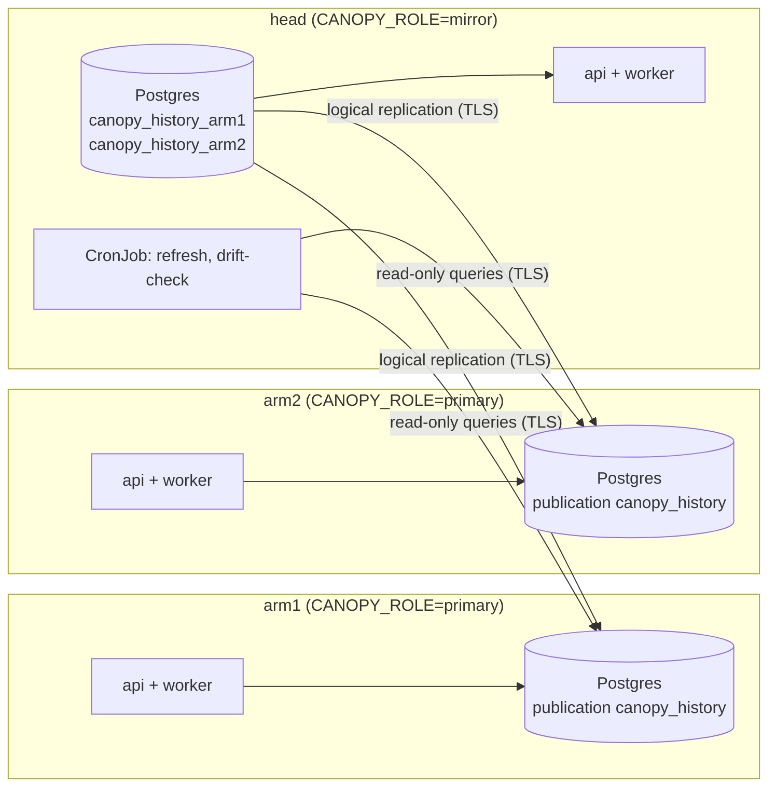

# History mirror

A history head is a copy of one or more Canopy instances' databases, its arms, kept
in step by Postgres logical replication. Remote users browse the full history there
while each arm goes on controlling its machine, and the head is the off-site copy of
the arms' data. Every row has one owner, the instance that wrote it, so the head keeps
each arm's rows apart, beside any rows it owns itself. An arm runs with
`CANOPY_ROLE=primary`, the head with `CANOPY_ROLE=mirror`.

The commands below are `python -m canopy.core.replication <command>`, run from the
Canopy image with the instance's `CANOPY_DATABASE_URL`, `CANOPY_ROLE` and
`CANOPY_INSTANCE`. Every command refuses to run on the wrong side. On the head, the
commands act on every arm configured in `CANOPY_ARMS__<arm>__…`, or on one with
`--arm <arm>`; `reseed` always names its arm.

## Topology



- **One connection direction.** Every connection opens from the head's side to an
  arm's Postgres: the head's subscription to that arm, `canopy_history_<arm>` (as the
  arm's replication role), and the drift check and re-seed (as its reader role). An
  arm never connects to the head.
- **Owners.** The arm that writes a row owns it (`owner_instance` on facilities, PVs,
  snapshots, tag groups and Magpie configs; other rows follow their parent). An arm
  holds only its own rows. The head holds every arm's rows plus its own, and the drift
  check and re-seed work on one arm's rows at a time.
- **What replicates.** `canopy.core.replication.registry` classifies every table.
  Reference tables (PVs, tags, configs) and time-series tables (snapshots and their
  values) replicate with inserts, updates and deletes. Local tables never replicate:
  each side mints and checks its own API keys. `TRUNCATE` isn't published, so one
  typed on an arm by hand doesn't empty history.
- **Schema.** Both sides run the same Alembic tree. A few migration steps run on one
  side only (see "Database Migrations" in `CONTRIBUTING.md`).

## Roles

### Instance roles

| `CANOPY_ROLE` | Holds | Writes |
|---|---|---|
| `primary` (default) | Only its own rows; publishes them, and may prune | Its own rows |
| `mirror` | Its arms' rows, beside its own; never prunes | Its own rows; an arm's rows on that arm, when the head forwards to it ([Writes on a head](#writes-on-a-head)) |

Every instance writes only the rows it owns (see [Row owners](index.md#row-owners)),
and a head meant to stay read-only gives its users read keys only. `GET /v1/instance`
reports the role and the instance's name, so clients can tell which rows they can
write, and the Alembic head shipped in the image, which the deploy check below
compares.

**API keys and facilities.** Each instance's API keys are its own, and a key's
facility grants are slugs. An arm refuses to delete a facility its own rows or keys
still use, and no other instance's rows can use it (a facility's rows share its
owner). What it can't see is the head's keys. A facility deleted on its arm is deleted
on the head too, and a head key that granted it silently stops reaching that
facility's data (a slug that no longer exists grants nothing). Check the head's keys
before deleting a facility on an arm, and re-grant them afterwards.

### Database roles

| Role | Database | Used by | Rights |
|---|---|---|---|
| `replicator` | each arm | The head's subscription to that arm | `REPLICATION LOGIN`; `publish` grants `SELECT` on the published tables only |
| `canopy_reader` | each arm | The head's `drift-check` and `reseed` for that arm | `LOGIN`; `publish` grants the same `SELECT`. It can't read API-key hashes |
| table owner (e.g. `canopy_owner`) | head | Migrations, `grants`, `refresh`, `subscribe` | Owns the tables; member of `pg_create_subscription` |
| `canopy_app` | head | The head's API and worker | `grants` lets it read every row and write only the head's own (row-level security on the root tables), and read-write its API keys |
| superuser | head | `reseed` | Or the table owner with `EXECUTE` on `pg_replication_origin_advance(text, pg_lsn)` |
| `canopy_heartbeat` | each arm that prunes | The head's `heartbeat` and `switch` for that arm | `LOGIN`; `publish` lets it read and write `core.history_heartbeat` and nothing else, and refuses if it can reach more through other roles or PUBLIC. Only needed for [pruning](#prune) |

The names are the defaults of `CANOPY_REPLICATION__REPLICATOR_ROLE`, `__READER_ROLE`,
`__APP_ROLE` and `__HEARTBEAT_ROLE`. Each arm's `pg_hba.conf` admits `replicator`,
`canopy_reader` and, where it prunes, `canopy_heartbeat` over `hostssl` with SCRAM
from the head's network only. The head reaches each arm with two secrets:
`CANOPY_ARMS__<arm>__PUBLISHER_DSN` (libpq, as the replication role) and
`CANOPY_ARMS__<arm>__READER_DSN` (a `postgresql://` URI, as the reader role), plus
`CANOPY_ARMS__<arm>__HEARTBEAT_DSN` (a URI, as the heartbeat role) for an arm that prunes.

Each arm's Postgres needs `wal_level = logical`, enough `max_replication_slots`
and `max_wal_senders`, and `max_slot_wal_keep_size` set **before the first slot
exists**: without a cap, a head that stops consuming makes the arm keep WAL until
its disk is full.

## Release order

The head always migrates first, so it never lacks a column or table an arm sends.

1. **Head**: `alembic upgrade head` (with `CANOPY_ROLE=mirror`), then `grants`, then
   `refresh`, as the table owner. Then roll out the head's API and worker.
2. **Each arm**: `alembic upgrade head`, then `publish`. Then roll out its API and
   worker.
3. The head's next hourly `refresh` copies any table first published in step 2.

A deploy pipeline can enforce the order: before step 2, compare `alembicHead` from the
head's `GET /v1/instance` with the head in the new image, and stop if the head is
behind.

**A release with `canopy_requires_primary_at`.** A revision that drops a column or
table on the head, or tightens a constraint after a backfill, names the earlier
revision every arm must already run (see "Database Migrations" in
`CONTRIBUTING.md`). Before step 1 of such a release, confirm that each arm runs that
revision or a later one (`alembic current` there), and that the head has caught up:
on each arm, `status` shows the head's slot `active` with `lag_bytes` at or near 0.
Otherwise the head could still be applying rows the migration would reject.

**First deployment.** Migrate the head and run `grants`. Then, for each arm: run
`publish` on it, and `subscribe --arm <arm>` once on the head, with that arm's
`CANOPY_ARMS__<arm>__PUBLISHER_DSN` from a secret. It copies every table the arm
publishes, then streams changes. `status` shows the copy's progress on either side.

**A second arm.** `reseed` works on one arm's rows. That must be in place on the head
before a second arm is connected: a re-seed that reconciled whole tables would delete
the other arms' rows.

## Operations

### CronJobs

On the head, hourly, for each arm: `refresh --arm <arm>`, then `drift-check --arm
<arm>` (with that arm's `CANOPY_ARMS__<arm>__READER_DSN`). `drift-check` exits 0 only
when every table the arm publishes was compared and is in step, 1 when the copy has
drifted, and 2 when it couldn't check every table, so anything but 0 fails the Job.
One Job per arm keeps one arm's failure from hiding another's result; without
`--arm`, one run checks every arm and exits with the worst. For an arm that prunes,
its Job also runs `heartbeat --arm <arm>` last, as described under [Prune](#prune).

### Backups

Back up the head like a primary, with base backups and WAL archiving. Each arm's rows
can be copied again from that arm, but the head's own rows exist only in its database
and its backups.

### Metrics and alerts

Each side's `/metrics` reports its half of replication: an arm's slot, and the head's
subscription to each arm (labelled `arm`). `/health/ready` checks the database. The
gauges, and the alert rules shipped in `docker/observability`, are listed under
[Replication](../observability/metrics.md#replication). The lag to watch is each
arm's `canopy_replication_slot_lag_bytes`; the head can't measure its own.

### Drift check

Replication skips an update or delete whose row the head doesn't have, without an
error, so the copy can drift with every gauge green. `drift-check` compares, for each
arm, the rows that arm owns, on the arm and on the head, in each table the arm's
subscription holds. Other arms' rows and the head's own are never compared:

- reference tables: row count and a hash of all rows;
- time-series tables: row counts per UTC day (snapshot values by their snapshot's
  day).

A table that differs is drift only when the comparison is conclusive: the arm's slot
has confirmed the position the arm was read at, the head still differs, and a second
read of the arm matches the first. Otherwise lag or a write landing between the reads
may explain it, so the table is tried again within `--settle` seconds (30 by default)
and then reported as inconclusive (exit 2). Tables still copying, or published but
not subscribed yet, are reported as not checked (also exit 2), and so is an arm that
can't be reached; the other arms are still checked.

Then the head checks its own references, once per run. Apply doesn't fire foreign
keys, so only the head can hold a row whose parent is gone (a snapshot value without
its snapshot, a PV's tag link without its tag). Each such row is put down to the arm
that owns it, through whichever of its parents survives, and is that arm's drift
(exit 1 for that arm only). A row nobody can be found to own is reported under `head`
and fails every run until it is fixed. A reference that is NULL is never flagged.

The JSON report gives `status`, then each arm's report under `arms` (drifting tables
and days) and the head's under `head`. To repair an arm's drift, find its cause, then
run `reseed --arm <arm>` with `--since` no later than the oldest drifting day
(reference tables and snapshots are always reconciled in full).

If `publish` on an arm ever reported tables it `cleared`, or `status` showed
`restricted` ones (a row filter or column list on the publication), a head that
subscribed while the restriction was in place holds only part of that arm's rows in
those tables, and `refresh` won't copy them again. Re-seed that arm.

## Prune

An arm whose disk can't hold all of its history keeps the last `CANOPY_WINDOW_DAYS`
days of snapshots and leaves older ones to the head. Turn this on only for an arm whose
sizing forecast says it's needed; arms may differ, one pruning on the split layout and
another on `canopy_history`. The head never prunes, its own rows included. Pruning takes
the three steps below, once per arm, then a worker setting on that arm. Prune deletes
must never reach the head, so the arm first moves to a second publication layout:
`canopy_ref` carries the reference tables with every operation, and `canopy_ts` carries
the time-series tables with inserts and updates only. User deletes still reach the head,
because deleting a snapshot or a PV only marks it deleted.

### Switch to the split layout

1. On the arm: `publish --split`. It creates `canopy_ref` and `canopy_ts` beside
   `canopy_history`. Deploys keep running plain `publish`, which keeps all three in
   step and never switches layouts.
2. On the head: `switch --arm <arm>`, with `CANOPY_ARMS__<arm>__HEARTBEAT_DSN` set to a
   URI to the arm as `canopy_heartbeat`. It waits (up to `--timeout`, 120 s) until the
   slot has confirmed a position taken after the pair existed, then moves that arm's
   subscription to the pair without copying. A subscription moved while its slot is
   still behind the pair's creation can't find the publications and retries forever.
   `switch` refuses if the subscription is disabled or the arm has no pair yet. Other
   arms' subscriptions are untouched.
3. On the arm: `publish --split` again. It drops `canopy_history` once the head's
   walsender is seen streaming exactly the pair, and exits 2 with the reason until
   then. Retry after a few seconds: the walsender restarts after the switch. Reading
   what a walsender streams needs a superuser or `pg_read_all_stats`.

From then on the head's subscription to that arm reads the pair. `reseed --arm <arm>`
creates it on the pair whenever the arm has it. To copy everything again instead, run
`subscribe --split --arm <arm>`.

### Heartbeat

The head reports its checks to each arm that prunes, hourly, last in that arm's Job:

```text
refresh --arm <arm>
drift-check --arm <arm> --days <the arm's CANOPY_WINDOW_DAYS>
heartbeat --arm <arm> [--backup-ok] [--wal-archive-ok] [--drift-ok]
```

Pass each flag only when that check passed: `--drift-ok` when that arm's `drift-check`
exited 0 (1, drift, and 2, couldn't check, both leave it out), and `--backup-ok` and
`--wal-archive-ok` from the backup system's own status. The backup and WAL archive are
the head's, so every arm's heartbeat gets the same two; only `--drift-ok` differs by
arm. A dangling row `drift-check` attributes to one arm fails only that arm's check; one
it can't attribute fails every arm's. Once an arm prunes, its `drift-check` needs
`--days`: days the arm has pruned would otherwise count as drift. `heartbeat` writes the
arm's `core.history_heartbeat` through `CANOPY_ARMS__<arm>__HEARTBEAT_DSN`, in a row named
after the head's slot there, timed by the arm's clock.

While that arm's subscription is disabled or any of its tables is still copying,
`heartbeat` records the drift check as failed whatever `--drift-ok` says: those tables
weren't compared, and rows pruned before a table's copy reads them would never reach
history. A heartbeat also counts only for the stream it was written in. After the head
reconnects to the arm, or its subscription is rebuilt, the arm's prune waits for the
next heartbeat.

### Turn pruning on

On the arm's worker, set `CANOPY_WINDOW_DAYS` and `CANOPY_PRUNE__ENABLED=true`. The job
runs nightly at `CANOPY_PRUNE__HOUR` (UTC); a head's worker never schedules it, and the
job refuses to run anywhere but on a primary. Until `CANOPY_PRUNE__DRY_RUN=false` it
only counts what it would remove. Run it dry for a month while the arm's `drift-check`
stays clean, then turn the dry run off.

Each run removes snapshots older than the window that aren't retained, deleted or
not, up to `CANOPY_PRUNE__MAX_SNAPSHOTS_PER_RUN`, one per transaction. Each facility
keeps its newest snapshot however old it is, so a facility history still refers to
stays in use and can't be deleted. Before every snapshot it checks a gate on the head's
slot `canopy_history_<CANOPY_INSTANCE>`, and it stops at the first failure, logging each
failed check by name:

| Check | Fails when |
|---|---|
| `window_set` | `CANOPY_WINDOW_DAYS` is unset |
| `no_delete_publication` | Any publication carrying a snapshot table publishes deletes (`canopy_history` still exists) |
| `slot_active` | The head's slot is missing or no walsender holds it |
| `streams_split` | The walsender doesn't stream both `canopy_ref` and `canopy_ts`, they don't carry the snapshot tables whole (no row filter or column list), or its command can't be read |
| `no_initial_copy` | A table's initial copy is running (a `pg_<oid>_sync_…` slot exists) |
| `wal_status_reserved` | The slot's WAL is at risk |
| `lag` | Flush lag or the head's last reply is older than `CANOPY_PRUNE__MAX_LAG_S` (60 s) |
| `heartbeat_fresh`, `heartbeat_ok` | No heartbeat within `CANOPY_PRUNE__HEARTBEAT_MAX_AGE_H` (3 h) and since the walsender started, or one reporting a failed check |

A snapshot older than the window can still be restored on its arm: export it from the
head (`GET /squirrel/v1/snapshots/{id}/export`) and import the bundle on the arm
(`POST /squirrel/v1/snapshots/import`), which creates a new, recent copy owned by the
arm. The copy keeps the snapshot's facility, which must be the arm's, so the import
needs a key that can write there. It takes only values of the arm's own PVs that the
key could restore and that are still assigned to that facility or one below it, as a
capture there would; a PV moved to another facility since the snapshot was taken is
left out and listed in the response's `skipped`. A snapshot with `retain` set is never
pruned. Prune can't see references held outside Canopy, so a service that refers to
snapshots, such as an optimization service's runs, sets `retain` on the ones it needs.

## Writes on a head

A head writes only its own rows, like every instance. A write to an arm's row goes to
that arm, over HTTPS, when the head forwards to it: the arm saves it, and the change
comes back through replication. An arm forwards when the head has both of its forward
settings, `CANOPY_ARMS__<arm>__FORWARD_URL` and `__SERVICE_KEY`. Without them the
arm's rows are read-only on the head, and a write to one is refused with 403
`not_owner`, naming the arm. `GET /v1/instance` shows each arm's `forwards`.

### Where each write goes

`canopy.core.forwarding.routes` names, for every write route, how the head finds the
owner of what it writes, in its own copy. A test fails when a route is neither routed
nor named as local.

| Writes | Owner |
|---|---|
| Snapshot edit, retain and delete; PV edit and delete; meta-PV edit and delete; tag group and tag changes; Magpie config edit and delete; facility edit and delete | The row's |
| Snapshot restore | Here with machine access `write`; otherwise the snapshot's ([Machine access](#machine-access)) |
| Snapshot capture | Taken here; saved here or on the facility's arm ([Snapshots taken on the head](#snapshots-taken-on-the-head)) |
| Snapshot history import | The facility's, from the body |
| PV create and PV import (`/pvs/multi`) | The facilities' in the body, which must share one owner |
| Meta-PV create | The owner of the PV at that address: the head's own first, else the one arm that holds it |
| Facility create | The parent's |
| Tag group create, tag import, Magpie config create, and any create above with no facility or parent | The head's, unless `?owner=` names another instance |
| API keys, Vole buffer evicts, analytics events, e-log entries and attachments, Hare PV writes | Always the head's own: never forwarded |

The creates that take a target from nothing else also take `?owner=<instance>`: a
forwardable arm's name sends the create to that arm, and any other name but the head's
is refused with 403 `not_owner`. A create whose `owner` contradicts its facility or
parent is answered by the head, with `not_owner` or 409 `owner_mismatch`. A facility
create sent to an arm whose slug the head already holds, under any owner, is refused
with 409 `facility_slug_conflict` before it is sent: slugs are unique across every
instance, and the arm's new row would otherwise stop replication from that arm.

A row or facility the head doesn't hold is answered by the head (404). A captured
import (`?mode=captured`) is never forwarded: it is how a head saves a snapshot it took
for an arm, and only a service key sends one, to the arm.

A snapshot an arm has pruned is still on the head. A change to it that the arm answers
with 404 is refused with 409 `archived_immutable`. To bring such a snapshot back to its
arm, export it on the head (`GET /squirrel/v1/snapshots/{id}/export`) and post the
bundle to `POST /squirrel/v1/snapshots/import`, which goes to the facility's arm and
creates a new snapshot there.

A forwarded restore runs as a job on the arm. Clients poll it on the head as usual:
`GET /jobs/v1/{id}` asks that arm about a job the head started there, for a day after
it started.

### Who wrote it

The head checks the caller's own key against the same gates the route has (write
scope and module; for facilities, admin over every facility), then calls the arm with
the head's service key there and names the caller in `X-Canopy-On-Behalf-Of`, as
`<key name>@<head>`, percent-encoded UTF-8 so a non-ASCII key name survives the trip.
The arm trusts that header only from a service key and only with
`CANOPY_ACCEPT_FORWARDED_WRITES=true`; otherwise it refuses the request with 403
`forwarded_write_refused`. It records the name in `createdBy` (snapshot captures,
Magpie configs) and logs it for imports.

The caller's facility grant goes with the request too, in
`X-Canopy-On-Behalf-Of-Facilities`, and the arm requires it alongside
`X-Canopy-On-Behalf-Of`. The arm's facility checks then allow only what both the
service key and the caller reach, so a caller keeps its own facility limits through
the head. Everything a forwarded write may change is that arm's own: the arm applies
its own rules to it, as for one of its local users, and the service key bounds the
rest.

The head checks the caller's grant first, for a snapshot change or a PV edit or
delete. A caller whose grant shares no facility with the row gets the head's own
answer, the same as on any instance, and nothing is sent to the arm: 404
`snapshot_not_found` for a snapshot, as `GET` answers, and 403
`insufficient_facility_access` for a PV or an unassigned snapshot. So the answer
doesn't depend on the arm being up, and doesn't say who owns the row.

Mint one service key on each arm, for that arm only, with the modules the head
forwards to it (`-m squirrel`, and `-m magpie` for Magpie configs), every facility
(`--facility '*'`) or only those the head's users work in. Each caller's own grant
still limits its requests. A key limited to some facilities must cover every one the
head's users reach on that arm. Otherwise the arm hides a snapshot outside them from the
key with a 404, and the head reads that as a prune (`archived_immutable`). Add `-a` only if the head should create, edit or delete the
arm's facilities: admin on the arm also manages that arm's API keys, and without it
the arm refuses facility writes with 403 `insufficient_admin_access`. Only the CLI
mints service keys:

```sh
python scripts/create_key.py head -r -w -m squirrel --facility '*' --service
```

### Reading your own write

For a forwarded request that committed a write, the arm returns
`X-Canopy-Commit-LSN`. The head waits up to `CANOPY_FORWARD__WAIT_S` (2 s) for its
subscription to that arm, `canopy_history_<arm>`, to reach that position
(`pg_replication_origin_status`). If it doesn't, the answer carries
`X-Canopy-Replica-Stale: true`: the write succeeded, but a read straight after it may
not show it yet. A capture commits later, in the arm's worker, so it carries no
position. Both headers are exposed through CORS, so a browser client on another
origin can read them. The wait includes getting a database connection, so a busy pool
marks the answer stale rather than delaying it.

The view is readable only by superusers by default. As a superuser on the head's
database, grant its app role both:

```sql
GRANT SELECT ON pg_replication_origin_status TO canopy_app;
GRANT EXECUTE ON FUNCTION pg_show_replication_origin_status() TO canopy_app;
```

Without them every forwarded write is marked stale.

### Settings

On the head, per arm it forwards to: `CANOPY_ARMS__<arm>__FORWARD_URL` (https) and
`CANOPY_ARMS__<arm>__SERVICE_KEY` from a secret, set together. A head with only one
of the two doesn't start. Optional, for every arm: `CANOPY_FORWARD__WAIT_S`,
`CANOPY_FORWARD__TIMEOUT_S` and `CANOPY_FORWARD__CA_BUNDLE`. On each arm:
`CANOPY_ACCEPT_FORWARDED_WRITES=true`. The full list is in the
[environment table](index.md). Deploy the head from the same release as its arms, so
what it forwards has the shapes they expect.

### Machine access

`CANOPY_MACHINE_ACCESS` says whether an instance writes to the machine: a Hare PV write
(`PUT /hare/v1/pvs/{pv}`) and a snapshot restore. It is `write` on a primary and `read`
on a head unless set. With `read` both are refused with 403 `machine_read_only`, and
the worker doesn't register the restore task; captures, which only read EPICS, run on
every instance.

With `write`, an instance restores from its own copy of the snapshot, a head an arm's
snapshot included, through its own EPICS gateway, which must then allow writes. With
`read`, a head sends a restore of a forwardable arm's snapshot to that arm, whose
worker runs it; a read-only arm's snapshot gets 403 `not_owner`, and the head's own
gets `machine_read_only`.

Nothing coordinates two instances writing the same IOCs. Give `write` to one instance
per facility, normally its arm. `GET /v1/instance` reports the setting as
`machineAccess`.

### Snapshots taken on the head

The head reads EPICS for every facility, so a capture runs on its own worker,
whoever owns the facility. A snapshot of the head's own facility is saved on the head.
One of a forwardable arm's facility (or with `?owner=` naming that arm) is read from
that arm's PVs, given an id and time on the head, and sent to the arm's captured
import (`POST /squirrel/v1/snapshots/import?mode=captured`) as the head's service key,
on the user's behalf. The arm saves it under that id, with the user as its author, and
replication brings it back to the head unchanged. A capture for a read-only arm's
facility is refused with 403 `not_owner` before anything is queued.

The capture job's result names the arm: `{"type": "snapshot", "id", "arm"}`, with the
values the arm left out under `skipped`. It waits up to `CANOPY_FORWARD__TIMEOUT_S`
(30 s) for the snapshot to come back; one that takes longer is saved on the arm all
the same. The captured import is idempotent on the id, so sending a bundle again
saves nothing twice. When the arm can't be reached, the job fails with
`primary_unavailable`, or with the arm's refusal.

### When an arm is unreachable

A forwarded write fails with 502 `primary_unavailable` when the arm couldn't be
reached; nothing was sent. It fails with 504 when the request went out and no answer
came back; the write may have been applied, so check before sending it again. Reads
keep working from the head's own copy, and so do writes to the head's own rows and to
other arms.

An arm that refuses the head's service key answers a forwarded write with 502
`service_key_refused`. That covers a 401, or a 403 for the key's scope, modules or
admin access (and on facility routes, for its facilities). The caller's own key is fine:
the head checked it first. The detail names the arm and relays its answer, for example
"Arm 'arm1' refused this head's service key for it (401 invalid_api_key: Invalid API
key)". `canopy_forwarded_requests_total` counts these with `outcome="key_refused"`.

To fix it, mint the arm's service key again with the modules and access the head
forwards (see [Who wrote it](#who-wrote-it)), and set it as
`CANOPY_ARMS__<arm>__SERVICE_KEY` on the head. A refusal that comes from the caller's
own facility grant, and `forwarded_write_refused`, reach the caller as the arm sent
them.

## Runbooks

Run SQL on the head as its superuser, from the history cluster's Postgres pod, and on
an arm as that arm's superuser. The head's subscription to an arm is
`canopy_history_<arm>`, and its slot on the arm has the same name. Each runbook acts
on one arm; the other arms keep streaming.

### Slot lost

**Signs**: an arm's slot shows `wal_status = lost`, and the head's apply worker for
that arm logs that it can't start streaming. The arm dropped WAL the head still
needed, so this subscription can't continue.

1. On the head, detach and drop that arm's subscription:
   ```sql
   ALTER SUBSCRIPTION canopy_history_<arm> DISABLE;
   ALTER SUBSCRIPTION canopy_history_<arm> SET (slot_name = NONE);
   DROP SUBSCRIPTION canopy_history_<arm>;
   ```
2. On the arm, drop the invalidated slot:
   `SELECT pg_drop_replication_slot('canopy_history_<arm>');`
3. On the head, find the newest snapshot it holds from that arm:
   `SELECT max(created_at) FROM squirrel.snapshot WHERE owner_instance = '<arm>';`
4. Run `reseed --arm <arm> --since <that time>` on the head, with that arm's
   `CANOPY_ARMS__<arm>__PUBLISHER_DSN` and `CANOPY_ARMS__<arm>__READER_DSN` set. It
   creates the subscription disabled and without a copy, copies what the head is
   missing of that arm's rows, and enables it from an exact cut, so nothing is copied
   and replayed both. Only rows that arm owns are written or deleted. Snapshots the
   head lacks are found by id, whatever their time; `--since` bounds which snapshots
   both sides hold get their values re-read. An earlier time is safe, only slower; a
   later one is refused. For an arm on the split layout the new subscription reads
   `canopy_ref` and `canopy_ts`.
5. Run `drift-check --arm <arm>`.

The cut needs a moment when no transaction on the arm takes a new transaction id.
`reseed` keeps trying for `--cut-wait` seconds (60 by default), waiting out writes that
are already open. On an arm that never pauses that long it refuses and changes
nothing: pause writes on the arm briefly (stop its API and worker), or retry at a
quieter time.

If `reseed` fails part-way, the subscription stays disabled: run it again. Never enable
the subscription by hand after a failed run, since replication would resume from where
the old slot left off, not from the copy.

### Head PITR

When the head's database must be restored to an earlier point in time (corruption,
or a mistake made on the head itself):

1. Restore it to time *T*, starting the restored server with
   `max_logical_replication_workers = 0`. Each restored subscription still points at
   its arm's slot, which is past *T*, and would otherwise resume from there and skip
   everything in between.
2. On the head, detach and drop every arm's subscription (step 1 of "Slot lost"). On
   each arm, drop the old slot, which is still holding WAL.
3. Restart the head with its usual `max_logical_replication_workers`.
4. For each arm in turn, run `reseed --arm <arm> --since <T>` (or the newest snapshot
   the restored database holds from that arm, if that's earlier), then `drift-check`.

The head's own rows written after *T* are lost: no arm holds them, only the head's
backups (see [Backups](#backups)).

### Arm wipe or rebuild

Wiping or rebuilding an arm's database drops its publication and slot, and the head's
subscription to it starts failing. The head still holds that arm's rows up to the
wipe.

1. Rebuild the arm's data. The head is normally newer than the arm's last dump, so
   rebuild from it as in "Arm host lost" below. If you restore a dump instead, also
   copy the head's rows that arm owns in the reference tables into the arm before
   step 3: `reseed` makes the head's copy of that arm's reference rows match the arm,
   and would delete whatever the dump lacks (and, through foreign keys, the snapshot
   values of a deleted PV).
2. On the arm: `alembic upgrade head`, then `publish`.
3. On the head: detach and drop that arm's old subscription (step 1 of "Slot lost"),
   then run `reseed --arm <arm> --since <time the rebuilt arm's data starts>` and
   `drift-check --arm <arm>`.

### Arm host lost

Rebuild the arm from the head, which holds every row that arm owns. API keys are
local, so they come from the arm's latest dump or are minted again.

1. On the new host, create the database and run `alembic upgrade head`.
2. From the head, copy the rows that arm owns, parents before children: the reference
   tables, then the time-series rows the arm should hold (all of them, or a recent
   window). Filter each root table on `owner_instance = '<arm>'` and each child table
   through its parent, for example
   `\copy (SELECT v.* FROM squirrel.snapshot_value v JOIN squirrel.snapshot s ON s.id = v.snapshot_id WHERE s.owner_instance = '<arm>') TO ...`
   on the head and `\copy ... FROM` on the arm. Never copy another owner's rows.
3. Restore or mint API keys, then run `publish`.
4. On the head: detach and drop that arm's old subscription, run
   `reseed --arm <arm> --since <newest snapshot on the head from that arm>`, then
   `drift-check --arm <arm>`.

### Bad update replicated

A bad write on an arm (a mass edit, a wrong delete) reaches the head within seconds.
Never repair an arm's rows on the head; repair them on that arm and let replication
carry the fix.

1. Restore the head's backup into a scratch database at a time before the bad write.
2. Extract the good rows that arm owns from it (`\copy (SELECT ...) TO`, filtered on
   the owner as in "Arm host lost").
3. Write them back on the arm, in one transaction, parents before children.
4. Run `drift-check --arm <arm>` on the head once replication has applied the fix.

### An arm's apply stopped on a duplicate key

**Signs**: the `canopy-replication-apply-stopped` alert fires for one arm. The head's
apply from that arm keeps failing on the same change and retrying, while the other
arms stream on. Most likely the arm created a facility slug or a Magpie config slug
that another owner, another arm or the head, already uses: those slugs are unique
across owners, and each arm only sees its own rows.

1. Find it: the head's Postgres log names the unique constraint and the value. Find
   the row on the head that holds the value, and its `owner_instance`.
2. Fix it: rename that row on its owner, on its arm, or on the head itself if the head
   owns it. The rename reaches the head, the slug is free, and the stuck change
   applies on the next retry.
3. Run `drift-check --arm <arm>` once the apply error count stops rising.

Don't skip the failing transaction: the arm's row would be missing on the head, and
re-seeding that arm would only meet the same clash.
