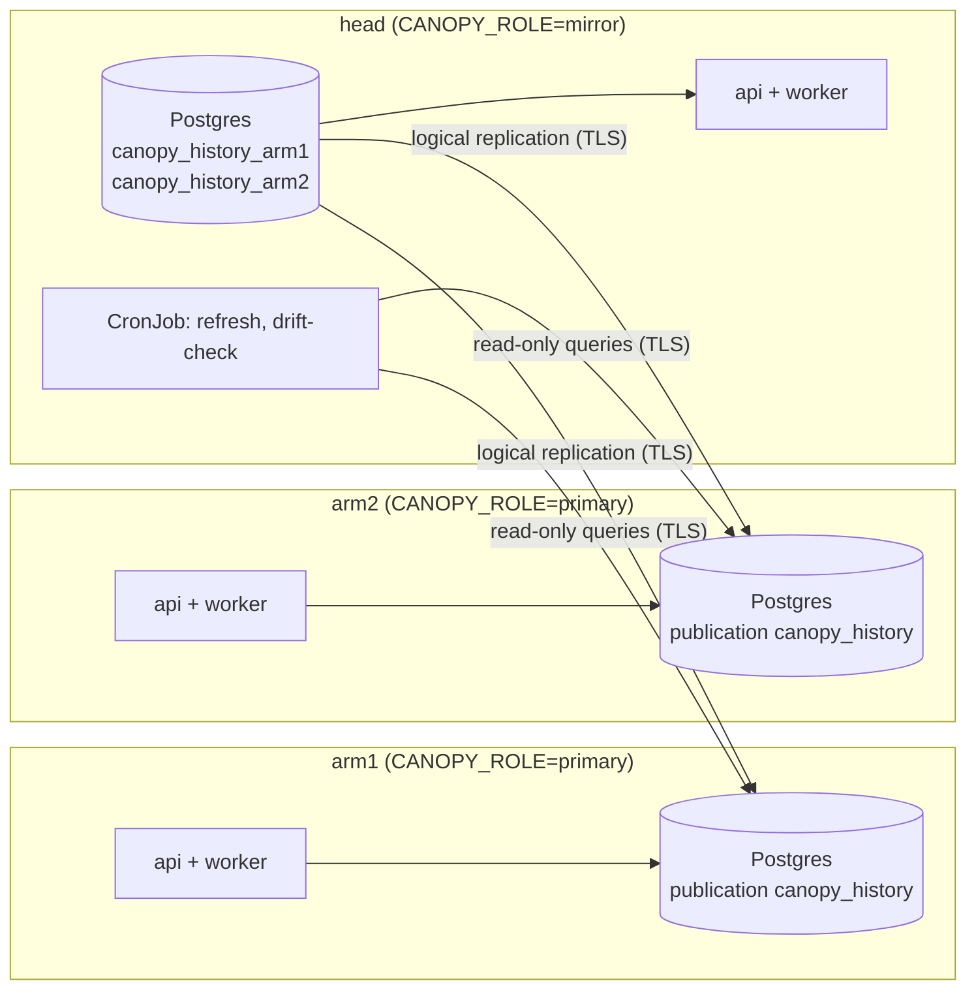

# History mirror

A history head is a copy of one or more Canopy instances' databases, its arms, kept
in step by Postgres logical replication. Remote users browse the full history there
while each arm goes on controlling its machine, and the head is the off-site copy of
the arms' data. Every row has one owner, the instance that wrote it, so the head keeps
each arm's rows apart, beside any rows it owns itself. An arm runs with
`CANOPY_ROLE=primary`, the head with `CANOPY_ROLE=mirror`.

The commands below are `python -m canopy.core.replication <command>`, run from the
Canopy image with the instance's `CANOPY_DATABASE_URL`, `CANOPY_ROLE` and
`CANOPY_INSTANCE`. Every command refuses to run on the wrong side. On the head, the
commands act on every arm configured in `CANOPY_ARMS__<arm>__…`, or on one with
`--arm <arm>`; `reseed` always names its arm.

## Topology



- **One connection direction.** Every connection opens from the head's side to an
  arm's Postgres: the head's subscription to that arm, `canopy_history_<arm>` (as the
  arm's replication role), and the drift check and re-seed (as its reader role). An
  arm never connects to the head.
- **Owners.** The arm that writes a row owns it (`owner_instance` on facilities, PVs,
  snapshots, tag groups and Magpie configs; other rows follow their parent). An arm
  holds only its own rows. The head holds every arm's rows plus its own, and the drift
  check and re-seed work on one arm's rows at a time.
- **What replicates.** `canopy.core.replication.registry` classifies every table.
  Reference tables (PVs, tags, configs) and time-series tables (snapshots and their
  values) replicate with inserts, updates and deletes. Local tables never replicate:
  each side mints and checks its own API keys. `TRUNCATE` isn't published, so one
  typed on an arm by hand doesn't empty history.
- **Schema.** Both sides run the same Alembic tree. A few migration steps run on one
  side only (see "Database Migrations" in `CONTRIBUTING.md`).

## Roles

### Instance roles

| `CANOPY_ROLE` | Holds | Writes |
|---|---|---|
| `primary` (default) | Only its own rows; publishes them, and may prune | Its own rows |
| `mirror` | Its arms' rows, beside its own; never prunes | Its own rows; an arm's rows are read-only here |

Every instance writes only the rows it owns (see [Row owners](index.md#row-owners)),
and a head meant to stay read-only gives its users read keys only. `GET /v1/instance`
reports the role and the instance's name, so clients can tell which rows they can
write, and the Alembic head shipped in the image, which the deploy check below
compares.

**API keys and facilities.** Each instance's API keys are its own, and a key's
facility grants are slugs. An arm refuses to delete a facility its own rows or keys
still use, and no other instance's rows can use it (a facility's rows share its
owner). What it can't see is the head's keys. A facility deleted on its arm is deleted
on the head too, and a head key that granted it silently stops reaching that
facility's data (a slug that no longer exists grants nothing). Check the head's keys
before deleting a facility on an arm, and re-grant them afterwards.

### Database roles

| Role | Database | Used by | Rights |
|---|---|---|---|
| `replicator` | each arm | The head's subscription to that arm | `REPLICATION LOGIN`; `publish` grants `SELECT` on the published tables only |
| `canopy_reader` | each arm | The head's `drift-check` and `reseed` for that arm | `LOGIN`; `publish` grants the same `SELECT`. It can't read API-key hashes |
| table owner (e.g. `canopy_owner`) | head | Migrations, `grants`, `refresh`, `subscribe` | Owns the tables; member of `pg_create_subscription` |
| `canopy_app` | head | The head's API and worker | `grants` lets it read every row and write only the head's own (row-level security on the root tables), and read-write its API keys |
| superuser | head | `reseed` | Or the table owner with `EXECUTE` on `pg_replication_origin_advance(text, pg_lsn)` |

The names are the defaults of `CANOPY_REPLICATION__REPLICATOR_ROLE`, `__READER_ROLE`
and `__APP_ROLE`. Each arm's `pg_hba.conf` admits `replicator` and `canopy_reader`
over `hostssl` with SCRAM from the head's network only. The head reaches each arm
with two secrets: `CANOPY_ARMS__<arm>__PUBLISHER_DSN` (libpq, as the replication
role) and `CANOPY_ARMS__<arm>__READER_DSN` (a `postgresql://` URI, as the reader role).

Each arm's Postgres needs `wal_level = logical`, enough `max_replication_slots`
and `max_wal_senders`, and `max_slot_wal_keep_size` set **before the first slot
exists**: without a cap, a head that stops consuming makes the arm keep WAL until
its disk is full.

## Release order

The head always migrates first, so it never lacks a column or table an arm sends.

1. **Head**: `alembic upgrade head` (with `CANOPY_ROLE=mirror`), then `grants`, then
   `refresh`, as the table owner. Then roll out the head's API and worker.
2. **Each arm**: `alembic upgrade head`, then `publish`. Then roll out its API and
   worker.
3. The head's next hourly `refresh` copies any table first published in step 2.

A deploy pipeline can enforce the order: before step 2, compare `alembicHead` from the
head's `GET /v1/instance` with the head in the new image, and stop if the head is
behind.

**A release with `canopy_requires_primary_at`.** A revision that drops a column or
table on the head, or tightens a constraint after a backfill, names the earlier
revision every arm must already run (see "Database Migrations" in
`CONTRIBUTING.md`). Before step 1 of such a release, confirm that each arm runs that
revision or a later one (`alembic current` there), and that the head has caught up:
on each arm, `status` shows the head's slot `active` with `lag_bytes` at or near 0.
Otherwise the head could still be applying rows the migration would reject.

**First deployment.** Migrate the head and run `grants`. Then, for each arm: run
`publish` on it, and `subscribe --arm <arm>` once on the head, with that arm's
`CANOPY_ARMS__<arm>__PUBLISHER_DSN` from a secret. It copies every table the arm
publishes, then streams changes. `status` shows the copy's progress on either side.

**A second arm.** `reseed` works on one arm's rows. That must be in place on the head
before a second arm is connected: a re-seed that reconciled whole tables would delete
the other arms' rows.

## Operations

### CronJobs

On the head, hourly, for each arm: `refresh --arm <arm>`, then `drift-check --arm
<arm>` (with that arm's `CANOPY_ARMS__<arm>__READER_DSN`). `drift-check` exits 0 only
when every table the arm publishes was compared and is in step, 1 when the copy has
drifted, and 2 when it couldn't check every table, so anything but 0 fails the Job.
One Job per arm keeps one arm's failure from hiding another's result; without
`--arm`, one run checks every arm and exits with the worst.

### Backups

Back up the head like a primary, with base backups and WAL archiving. Each arm's rows
can be copied again from that arm, but the head's own rows exist only in its database
and its backups.

### Metrics and alerts

Each side's `/metrics` reports its half of replication: an arm's slot, and the head's
subscription to each arm (labelled `arm`). `/health/ready` checks the database. The
gauges, and the alert rules shipped in `docker/observability`, are listed under
[Replication](../observability/metrics.md#replication). The lag to watch is each
arm's `canopy_replication_slot_lag_bytes`; the head can't measure its own.

### Drift check

Replication skips an update or delete whose row the head doesn't have, without an
error, so the copy can drift with every gauge green. `drift-check` compares, for each
arm, the rows that arm owns, on the arm and on the head, in each table the arm's
subscription holds. Other arms' rows and the head's own are never compared:

- reference tables: row count and a hash of all rows;
- time-series tables: row counts per UTC day (snapshot values by their snapshot's
  day).

A table that differs is drift only when the comparison is conclusive: the arm's slot
has confirmed the position the arm was read at, the head still differs, and a second
read of the arm matches the first. Otherwise lag or a write landing between the reads
may explain it, so the table is tried again within `--settle` seconds (30 by default)
and then reported as inconclusive (exit 2). Tables still copying, or published but
not subscribed yet, are reported as not checked (also exit 2), and so is an arm that
can't be reached; the other arms are still checked.

Then the head checks its own references, once per run. Apply doesn't fire foreign
keys, so only the head can hold a row whose parent is gone (a snapshot value without
its snapshot, a PV's tag link without its tag). Each such row is put down to the arm
that owns it, through whichever of its parents survives, and is that arm's drift
(exit 1 for that arm only). A row nobody can be found to own is reported under `head`
and fails every run until it is fixed. A reference that is NULL is never flagged.

The JSON report gives `status`, then each arm's report under `arms` (drifting tables
and days) and the head's under `head`. To repair an arm's drift, find its cause, then
run `reseed --arm <arm>` with `--since` no later than the oldest drifting day
(reference tables and snapshots are always reconciled in full).

If `publish` on an arm ever reported tables it `cleared`, or `status` showed
`restricted` ones (a row filter or column list on the publication), a head that
subscribed while the restriction was in place holds only part of that arm's rows in
those tables, and `refresh` won't copy them again. Re-seed that arm.

## Runbooks

Run SQL on the head as its superuser, from the history cluster's Postgres pod, and on
an arm as that arm's superuser. The head's subscription to an arm is
`canopy_history_<arm>`, and its slot on the arm has the same name. Each runbook acts
on one arm; the other arms keep streaming.

### Slot lost

**Signs**: an arm's slot shows `wal_status = lost`, and the head's apply worker for
that arm logs that it can't start streaming. The arm dropped WAL the head still
needed, so this subscription can't continue.

1. On the head, detach and drop that arm's subscription:
   ```sql
   ALTER SUBSCRIPTION canopy_history_<arm> DISABLE;
   ALTER SUBSCRIPTION canopy_history_<arm> SET (slot_name = NONE);
   DROP SUBSCRIPTION canopy_history_<arm>;
   ```
2. On the arm, drop the invalidated slot:
   `SELECT pg_drop_replication_slot('canopy_history_<arm>');`
3. On the head, find the newest snapshot it holds from that arm:
   `SELECT max(created_at) FROM squirrel.snapshot WHERE owner_instance = '<arm>';`
4. Run `reseed --arm <arm> --since <that time>` on the head, with that arm's
   `CANOPY_ARMS__<arm>__PUBLISHER_DSN` and `CANOPY_ARMS__<arm>__READER_DSN` set. It
   creates the subscription disabled and without a copy, copies what the head is
   missing of that arm's rows, and enables it from an exact cut, so nothing is copied
   and replayed both. Only rows that arm owns are written or deleted. Snapshots the
   head lacks are found by id, whatever their time; `--since` bounds which snapshots
   both sides hold get their values re-read. An earlier time is safe, only slower; a
   later one is refused.
5. Run `drift-check --arm <arm>`.

The cut needs a moment when no transaction on the arm takes a new transaction id.
`reseed` keeps trying for `--cut-wait` seconds (60 by default), waiting out writes that
are already open. On an arm that never pauses that long it refuses and changes
nothing: pause writes on the arm briefly (stop its API and worker), or retry at a
quieter time.

If `reseed` fails part-way, the subscription stays disabled: run it again. Never enable
the subscription by hand after a failed run, since replication would resume from where
the old slot left off, not from the copy.

### Head PITR

When the head's database must be restored to an earlier point in time (corruption,
or a mistake made on the head itself):

1. Restore it to time *T*, starting the restored server with
   `max_logical_replication_workers = 0`. Each restored subscription still points at
   its arm's slot, which is past *T*, and would otherwise resume from there and skip
   everything in between.
2. On the head, detach and drop every arm's subscription (step 1 of "Slot lost"). On
   each arm, drop the old slot, which is still holding WAL.
3. Restart the head with its usual `max_logical_replication_workers`.
4. For each arm in turn, run `reseed --arm <arm> --since <T>` (or the newest snapshot
   the restored database holds from that arm, if that's earlier), then `drift-check`.

The head's own rows written after *T* are lost: no arm holds them, only the head's
backups (see [Backups](#backups)).

### Arm wipe or rebuild

Wiping or rebuilding an arm's database drops its publication and slot, and the head's
subscription to it starts failing. The head still holds that arm's rows up to the
wipe.

1. Rebuild the arm's data. The head is normally newer than the arm's last dump, so
   rebuild from it as in "Arm host lost" below. If you restore a dump instead, also
   copy the head's rows that arm owns in the reference tables into the arm before
   step 3: `reseed` makes the head's copy of that arm's reference rows match the arm,
   and would delete whatever the dump lacks (and, through foreign keys, the snapshot
   values of a deleted PV).
2. On the arm: `alembic upgrade head`, then `publish`.
3. On the head: detach and drop that arm's old subscription (step 1 of "Slot lost"),
   then run `reseed --arm <arm> --since <time the rebuilt arm's data starts>` and
   `drift-check --arm <arm>`.

### Arm host lost

Rebuild the arm from the head, which holds every row that arm owns. API keys are
local, so they come from the arm's latest dump or are minted again.

1. On the new host, create the database and run `alembic upgrade head`.
2. From the head, copy the rows that arm owns, parents before children: the reference
   tables, then the time-series rows the arm should hold (all of them, or a recent
   window). Filter each root table on `owner_instance = '<arm>'` and each child table
   through its parent, for example
   `\copy (SELECT v.* FROM squirrel.snapshot_value v JOIN squirrel.snapshot s ON s.id = v.snapshot_id WHERE s.owner_instance = '<arm>') TO ...`
   on the head and `\copy ... FROM` on the arm. Never copy another owner's rows.
3. Restore or mint API keys, then run `publish`.
4. On the head: detach and drop that arm's old subscription, run
   `reseed --arm <arm> --since <newest snapshot on the head from that arm>`, then
   `drift-check --arm <arm>`.

### Bad update replicated

A bad write on an arm (a mass edit, a wrong delete) reaches the head within seconds.
Never repair an arm's rows on the head; repair them on that arm and let replication
carry the fix.

1. Restore the head's backup into a scratch database at a time before the bad write.
2. Extract the good rows that arm owns from it (`\copy (SELECT ...) TO`, filtered on
   the owner as in "Arm host lost").
3. Write them back on the arm, in one transaction, parents before children.
4. Run `drift-check --arm <arm>` on the head once replication has applied the fix.

### An arm's apply stopped on a duplicate key

**Signs**: the `canopy-replication-apply-stopped` alert fires for one arm. The head's
apply from that arm keeps failing on the same change and retrying, while the other
arms stream on. Most likely the arm created a facility slug or a Magpie config slug
that another owner, another arm or the head, already uses: those slugs are unique
across owners, and each arm only sees its own rows.

1. Find it: the head's Postgres log names the unique constraint and the value. Find
   the row on the head that holds the value, and its `owner_instance`.
2. Fix it: rename that row on its owner, on its arm, or on the head itself if the head
   owns it. The rename reaches the head, the slug is free, and the stuck change
   applies on the next retry.
3. Run `drift-check --arm <arm>` once the apply error count stops rising.

Don't skip the failing transaction: the arm's row would be missing on the head, and
re-seeding that arm would only meet the same clash.
