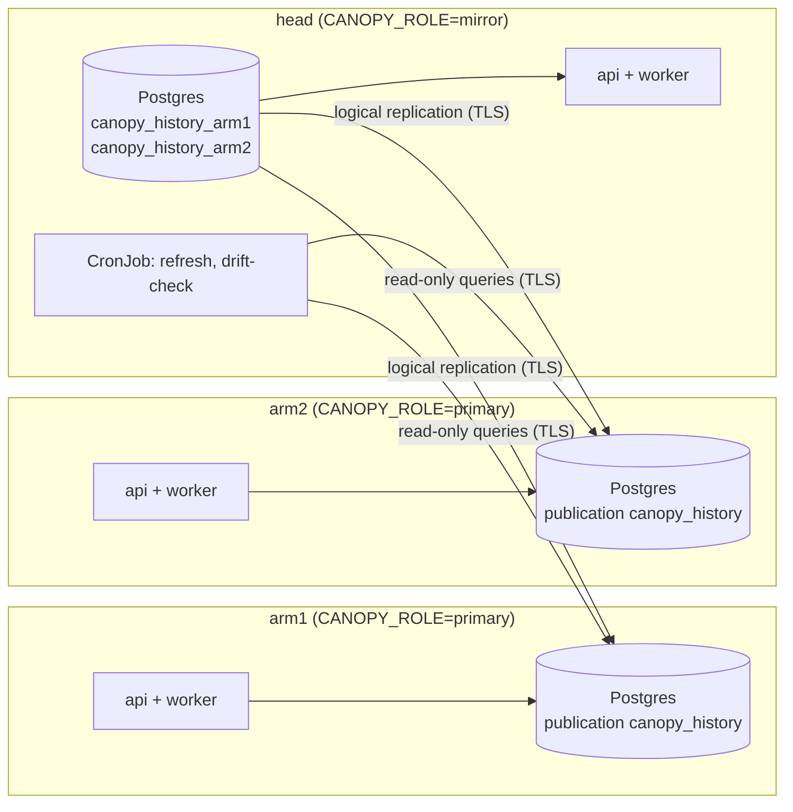

# History

A history head is a copy of one or more Canopy instances' databases, its arms, kept
in step by Postgres logical replication. Remote users browse the full history there
while each arm goes on controlling its machine, and the head is the off-site copy of
the arms' data. Every row has one owner, the instance that wrote it, so the head keeps
each arm's rows apart, beside any rows it owns itself. An arm runs with
`CANOPY_ROLE=primary`, the head with `CANOPY_ROLE=mirror`. One primary with one mirror
is the one-arm case; a single instance is the case with no head.

This section has four pages:

- **This page**: what each database holds and does, the roles, and what to back up.
- [Topologies](topologies.md): how to set Canopy up, from a single instance to many
  arms and one head, and what keeps working while a link is down.
- [Operations](operations.md): release order, the hourly jobs, metrics, the drift
  check, writes on a head, the snapshot outbox, prune, and every setting.
- [Runbooks](runbooks.md): what to do when a slot is lost, a database is restored or
  rebuilt, a bad update replicates, or an arm's apply stops.

The commands in this section are `python -m canopy.core.replication <command>`, run
from the Canopy image with the instance's `CANOPY_DATABASE_URL`, `CANOPY_ROLE` and
`CANOPY_INSTANCE`. Every command refuses to run on the wrong side. On the head, the
commands act on every arm configured in `CANOPY_ARMS__<arm>__…`, or on one with
`--arm <arm>`; `reseed`, `switch` and `heartbeat` always name their arm.

## Topology

- **One connection direction.** Every connection opens from the head's side to an
  arm: the head's subscription to that arm, `canopy_history_<arm>` (as the arm's
  replication role), the drift check and re-seed (as its reader role), the heartbeat
  (as its heartbeat role), and forwarded writes to the arm's API over HTTPS. An arm
  never connects to the head.
- **Owners.** The instance that writes a row owns it (`owner_instance` on facilities,
  PVs, snapshots, tag groups and Magpie configs; other rows follow their parent; see
  [Row owners](../index.md#row-owners)). An arm holds only its own rows. The head
  holds every arm's rows plus its own, and the drift check and re-seed work on one
  arm's rows at a time.
- **What replicates.** `canopy.core.replication.registry` classifies every table.
  Reference tables (PVs, tags, configs) and time-series tables (snapshots and their
  values) replicate with inserts, updates and deletes. Local tables never replicate:
  each instance mints and checks its own API keys. `TRUNCATE` isn't published, so one
  typed on an arm by hand doesn't empty history.
- **Schema.** Every instance runs the same Alembic tree. A few migration steps run on
  an arm or on the head only, and data steps change only the rows the instance owns
  (see "Database Migrations" in `CONTRIBUTING.md`).

## What each database holds

| | Single instance | Arm | Head |
|---|---|---|---|
| Reference tables (facilities, PVs, tags, meta-PVs, Magpie configs, PV-facility links) | Its own | Its own, published | Every arm's, by subscription, plus its own |
| Time-series tables (snapshots and their values) | Its own | Its own; a recent window if it [prunes](operations.md#prune) | Every arm's, never pruned, plus its own |
| `core.api_key` (local) | Its keys | Its keys, including its head's service key | Its keys, for the head's users |
| `core.history_heartbeat` (local) | | A row the head writes after each check, if it prunes | Empty |
| `squirrel.snapshot_outbox` (local) | Empty | Empty | Snapshots waiting for an arm ([outbox](operations.md#when-an-arm-is-unreachable)) |
| Publications | | `canopy_history`, or `canopy_ref` and `canopy_ts` once it prunes | |
| Replication | | Slot `canopy_history_<arm>`, capped by `max_slot_wal_keep_size` | One subscription per arm, of the same name |
| Prune | | Gated on its one slot and the head's heartbeat | Never |

## Roles

### Instance roles

| `CANOPY_ROLE` | Holds | Writes |
|---|---|---|
| `primary` (default) | Only its own rows; publishes them, and may prune | Its own rows |
| `mirror` | Its arms' rows, beside its own; never prunes | Its own rows; an arm's rows on that arm, when the head forwards to it ([Writes on a head](operations.md#writes-on-a-head)) |

Every instance writes only the rows it owns, and a head meant to stay read-only gives
its users read keys only. `GET /v1/instance` reports the role, the instance's name,
the Alembic head shipped in the image (which the deploy check compares), and on a head
each arm with its subscription's state and whether the head forwards to it.

**API keys and facilities.** Each instance's API keys are its own, and a key's
facility grants are slugs. An arm refuses to delete a facility its own rows or keys
still use, and no other instance's rows can use it (a facility's rows share its
owner). What it can't see is the head's keys. A facility deleted on its arm is deleted
on the head too, and a head key that granted it silently stops reaching that
facility's data (a slug that no longer exists grants nothing). Check the head's keys
before deleting a facility on an arm, and re-grant them afterwards.

### Database roles

| Role | Database | Used by | Rights |
|---|---|---|---|
| `replicator` | each arm | The head's subscription to that arm | `REPLICATION LOGIN`; `publish` grants `SELECT` on the published tables only |
| `canopy_reader` | each arm | The head's `drift-check` and `reseed` for that arm | `LOGIN`; `publish` grants the same `SELECT`. It can't read API-key hashes |
| table owner (e.g. `canopy_owner`) | head | Migrations, `grants`, `refresh`, `subscribe` | Owns the tables; member of `pg_create_subscription` |
| `canopy_app` | head | The head's API and worker | `grants` lets it read every row and write only the head's own (row-level security on the root tables), and read-write its API keys |
| superuser | head | `reseed` | Or the table owner with `EXECUTE` on `pg_replication_origin_advance(text, pg_lsn)` |
| `canopy_heartbeat` | each arm that prunes | The head's `heartbeat` and `switch` for that arm | `LOGIN`; `publish` lets it read and write `core.history_heartbeat` and nothing else, and refuses if it can reach more through other roles or PUBLIC. Only needed for [pruning](operations.md#prune) |

The names are the defaults of `CANOPY_REPLICATION__REPLICATOR_ROLE`, `__READER_ROLE`,
`__APP_ROLE` and `__HEARTBEAT_ROLE`. Each arm's `pg_hba.conf` admits `replicator`,
`canopy_reader` and, where it prunes, `canopy_heartbeat` over `hostssl` with SCRAM
from the head's network only. The head reaches each arm with two secrets:
`CANOPY_ARMS__<arm>__PUBLISHER_DSN` (libpq, as the replication role) and
`CANOPY_ARMS__<arm>__READER_DSN` (a `postgresql://` URI, as the reader role), plus
`CANOPY_ARMS__<arm>__HEARTBEAT_DSN` (a URI, as the heartbeat role) for an arm that
prunes. `subscribe` and `refresh` also open the publisher connection themselves, from
wherever the CLI runs, to check slugs before a copy: that host must resolve the arm the
same way the head's Postgres does.

Each arm's Postgres needs `wal_level = logical`, enough `max_replication_slots`
and `max_wal_senders`, and `max_slot_wal_keep_size` set **before the first slot
exists**: without a cap, a head that stops consuming makes the arm keep WAL until
its disk is full.

## Backups

Back up the head like a primary, with base backups and WAL archiving. Each arm's rows
can be copied again from that arm, but **the head's own rows exist only in its database
and its backups**, and so do snapshots waiting in its outbox for an arm. An arm that
prunes keeps only its window, so its older snapshots exist only on the head and in the
head's backups. Each arm's backups hold that arm's rows.

## What always holds

- Every row has one owner, and only its owner writes it; the head writes only rows it
  owns.
- Only snapshots queue for an arm that can't be reached; every other write to its rows
  is refused.
- Prune runs only on an arm, behind its head's gate; the head never prunes.
- Deleting a snapshot or a PV only marks it deleted; nothing is purged.

The shapes this doesn't support, such as two heads for one arm or heads in a chain,
are listed under [Topologies](topologies.md#shapes-that-arent-supported).
