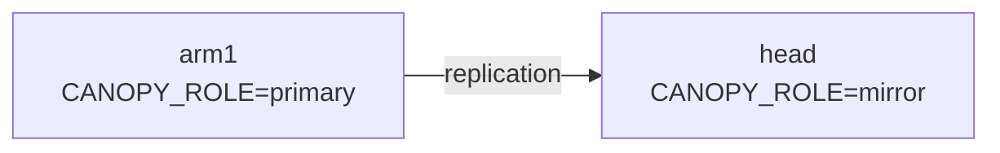
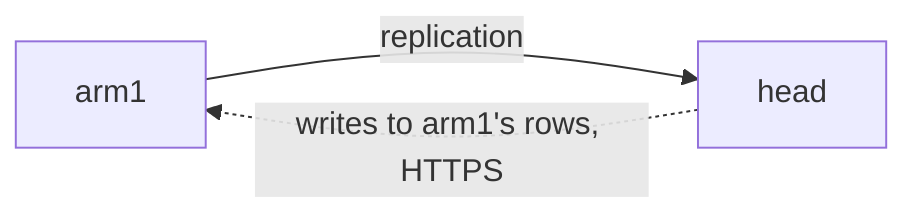
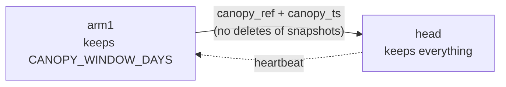
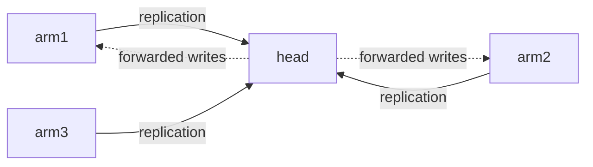

# History topologies

Canopy keeps history the same way at every size: each **arm** (`CANOPY_ROLE=primary`)
writes and publishes its own rows, and one **head** (`CANOPY_ROLE=mirror`) subscribes
to every arm, keeps their rows for good, and may own rows of its own. A single
instance is the case with no head; one primary and one mirror is the case with one
arm. Every topology below runs the same code with different settings.

For each one, this page says which settings go on which side, which commands run and
in what order, what replicates, what is pruned and what is backed up, and what keeps
working while a link is down. What each database holds is on the [overview](index.md), the mechanisms under
[Operations](operations.md), and repairs under [Runbooks](runbooks.md).

| Topology | Arms | The head writes | Prunes |
|---|---|---|---|
| [1. A single instance](#1-a-single-instance) | none | n/a | no |
| [2. A primary and a read-only mirror](#2-a-primary-and-a-read-only-mirror) | one, read-only on the head | its own rows only | no |
| [3. A mirror that forwards writes](#3-a-mirror-that-forwards-writes) | one, forwarding | its own rows; forwards the arm's | no |
| [4. A primary with prune](#4-a-primary-with-prune) | one | as in 2 or 3 | the arm, behind a gate |
| [5. Several arms and one head](#5-several-arms-and-one-head) | many, each forwarding or read-only | per arm | per arm |
| [6. A head that owns its own facilities](#6-a-head-that-owns-its-own-facilities) | any | its own facilities, locally | never on the head |
| [7. A head with EPICS read or write](#7-a-head-with-epics-read-or-write) | any | restores, with `write` | |
| [8. An arm that can't be reached](#8-an-arm-that-cant-be-reached) | any | queues captures | the gate holds |

The links that can go down between an arm and its head:

- **Replication**: the head's subscription `canopy_history_<arm>` to the arm's Postgres.
- **Checks**: the head's `drift-check`, `reseed` and `heartbeat` against the arm's Postgres.
- **Forwarding**: the head's requests to the arm's API over HTTPS.
- **EPICS**: an instance's own gateway to the machine.

Every connection opens from the head; an arm never connects to its head.

## 1. A single instance

One primary, no history copy. This is the default.

**Settings.** `CANOPY_INSTANCE=<name>`, which is required and permanent (see
[Row owners](../index.md#row-owners)). `CANOPY_ROLE` stays `primary`, and
`CANOPY_MACHINE_ACCESS` defaults to `write` there.

**Commands.** `alembic upgrade head` on each release. The first upgrade to a release
with row owners stamps every existing row with the instance's name.

**Replicated, pruned, backed up.** Nothing replicates and nothing is pruned. The
instance's own backups hold everything.

**While a link is down.** Only EPICS can be: captures and restores fail, as they
always have.

## 2. A primary and a read-only mirror

An off-site copy of every row, for browsing history, with no writes back to the arm.



**Settings.**

- **arm1**: `CANOPY_INSTANCE=arm1`. Its Postgres has `wal_level = logical`, a
  `max_slot_wal_keep_size` cap set before the first slot exists, and `pg_hba.conf`
  lines for `replicator` and `canopy_reader` from the head's network (see
  [Database roles](index.md#database-roles)).
- **head**: `CANOPY_ROLE=mirror`, `CANOPY_INSTANCE=head`, and from secrets
  `CANOPY_ARMS__ARM1__PUBLISHER_DSN` and `CANOPY_ARMS__ARM1__READER_DSN`. Its own Redis.
  Leave out the forward settings: arm1's rows are then read-only on the head, and a
  write to one is refused with 403 `not_owner`. To keep the head fully read-only,
  give its users read keys only; it would otherwise accept rows of its own
  ([topology 6](#6-a-head-that-owns-its-own-facilities)).

**Commands, in order.**

1. Head: `alembic upgrade head`, then `grants`.
2. arm1: `alembic upgrade head`, then `publish`.
3. Head, once: `subscribe`. It copies every table arm1 publishes, then streams.
4. Head, hourly: `refresh`, then `drift-check`.

On every later release the head migrates first (see
[Release order](operations.md#release-order)).

**Replicated, pruned, backed up.** arm1's reference and time-series rows reach the
head. API keys, the heartbeat table and the outbox stay local to each side. Nothing is
pruned. Both sides' backups hold arm1's rows.

**While a link is down.**

- **Replication**: the head serves reads as of the break. arm1 keeps its slot's WAL up
  to the cap, and the head's `receive-stale` alert fires. Past the cap the slot is
  lost: follow [Slot lost](runbooks.md#slot-lost).
- **Checks**: `drift-check` exits 2 for arm1.
- arm1 notices neither.

## 3. A mirror that forwards writes

Users at the head can save, edit and capture; arm1 stays the only writer of its rows,
and every change comes back by replication.



**Settings.**

- **arm1**: `CANOPY_ACCEPT_FORWARDED_WRITES=true`, and a service key for the head,
  minted there:
  ```sh
  python scripts/create_key.py head -r -w -m squirrel --facility '*' --service
  ```
  Add `-m magpie` if the head's users edit arm1's Magpie configs, and `-m core -a` only
  if the head should create, edit or delete arm1's facilities: an admin key on arm1
  also manages arm1's API keys (see [Who wrote it](operations.md#who-wrote-it)).
- **head**: as in topology 2, plus `CANOPY_ARMS__ARM1__FORWARD_URL` (https) and
  `CANOPY_ARMS__ARM1__SERVICE_KEY` from a secret, set together. Optionally
  `CANOPY_FORWARD__WAIT_S`, `__TIMEOUT_S` and `__CA_BUNDLE`. A superuser on the head
  grants its app role `SELECT` on `pg_replication_origin_status` and `EXECUTE` on
  `pg_show_replication_origin_status()`, or every forwarded answer is marked stale
  (grant the table owner the same, or run `status` as a superuser).

**Commands.** As in topology 2. Deploy the head from the same release as arm1.

**Replicated, pruned, backed up.** As in topology 2. A write the head forwards is
saved on arm1, and the head waits up to `WAIT_S` for it to come back. A capture is
taken on the head and saved on arm1 under the head's id (see
[Snapshots taken on the head](operations.md#snapshots-taken-on-the-head)).

**While a link is down.**

- **Forwarding**: a write to arm1's rows fails with 502 `primary_unavailable` (nothing
  sent) or 504 (it may have landed). A capture for arm1 waits in the head's outbox
  ([topology 8](#8-an-arm-that-cant-be-reached)). An arm1 that turns down the head's
  service key gives 502 `service_key_refused`, naming arm1: mint the key again.
- **Replication**, with forwarding up: writes succeed on arm1, and their answers carry
  `X-Canopy-Replica-Stale: true`.

## 4. A primary with prune

An arm whose disk holds only a recent window; the head keeps everything. Turn it on
only where the arm's sizing forecast needs it.



**Settings.**

- **arm1**: `CANOPY_WINDOW_DAYS`, then `CANOPY_PRUNE__ENABLED=true` on its worker, with
  `CANOPY_PRUNE__DRY_RUN` left `true` at first; a `pg_hba.conf` line for
  `canopy_heartbeat`.
- **head**: `CANOPY_ARMS__ARM1__HEARTBEAT_DSN` from a secret.

**Commands, in order.**

1. arm1: `publish --split`.
2. Head: `switch --arm arm1`.
3. arm1: `publish --split` again, until it reports `canopy_history` dropped.
4. Head, hourly: `refresh --arm arm1`,
   `drift-check --arm arm1 --days <arm1's CANOPY_WINDOW_DAYS>`, then
   `heartbeat --arm arm1`, with `--drift-ok` only when the drift check exited 0.
5. Run the prune dry for a month while the drift check stays clean, then set
   `CANOPY_PRUNE__DRY_RUN=false`.

**Replicated, pruned, backed up.** Snapshots older than the window that aren't
retained, and aren't their facility's newest, leave arm1; their deletes aren't
published, so the head keeps them. The head never prunes. arm1's backups hold its
window, the head's the rest. An old snapshot comes back to arm1 by export from the
head and import there (see [Prune](operations.md#prune)).

**While a link is down.** The prune stops at its gate (slot inactive, lag, or no fresh
heartbeat) and resumes after the next good heartbeat. Nothing is lost.

## 5. Several arms and one head

Each site keeps its own primary; the head sees all of them. Each arm is forwarding
or read-only on the head, and prunes or not, on its own.



**Settings.** On the head, one `CANOPY_ARMS__<arm>__…` block per arm, named after
that arm's `CANOPY_INSTANCE`; each arm is set up as in topologies 2 to 4. Arm names,
facility slugs and Magpie config slugs must be unique across the arms and the head.
A PV's setpoint address and a tag group's name need only be unique per owner, so the
same PV can live on two arms.

**Commands.**

- **Adding an arm**: `publish` on it, then `subscribe --arm <arm>` on the head. It
  refuses if the head already holds that arm's rows or one of its slugs, then copies
  while the other arms stream on. Re-seed works on one arm's rows, and must be in
  place before a second arm connects.
- **Every hour**: one Job per arm, `refresh --arm <arm>` and
  `drift-check --arm <arm>` (and `heartbeat --arm <arm>` where it prunes), so one arm's
  failure doesn't hide another's. Each run also checks the head's own references
  once.
- **Releases**: the head first, then each arm, in any order. Arms may sit at different
  revisions; before a release that declares `canopy_requires_primary_at`, confirm
  every arm runs that revision.
- **Removing an arm**: take its settings off the head. `status` then lists its
  subscription under `unexpected`, and `canopy-replication-subscription-unlisted`
  fires. Then run `DROP SUBSCRIPTION canopy_history_<arm>` on the head, which also
  drops the slot on the arm if the arm can be reached. If it can't, disable the
  subscription, `SET (slot_name = NONE)`, drop it, and drop the slot on the arm later:
  until then the slot holds the arm's WAL. The arm's rows stay on the head as a
  read-only archive.

**Replicated, pruned, backed up.** Per arm, as in topologies 2 to 4. The head's
backups are the one place every arm's full history meets.

**While a link is down.** Only that arm is affected; the others stream and forward as
usual. A slug that two owners create while both stream stops the later one's apply,
and `canopy-replication-apply-stopped` fires for that arm (see
[An arm's apply stopped on a duplicate key](runbooks.md#an-arms-apply-stopped-on-a-duplicate-key)).

## 6. A head that owns its own facilities

Facilities only the head's users work with, written straight into the head.

**Settings.** None. A root facility created on the head, through the API or the
facility scripts, belongs to the head, and everything under it follows. A tag group or
Magpie config created on the head is the head's too, unless the request names an arm
with `?owner=`.

**Commands.** None beyond the head's own. A data migration runs on every instance,
each changing only the rows it owns.

**Replicated, pruned, backed up.** Nothing: the head's own rows are never published,
compared, re-seeded or pruned, and **they exist only in the head's database and its
backups**. Back the head up like a primary, with base backups and WAL archiving (see
[Backups](index.md#backups)). A point-in-time restore of the head loses its own
rows written after the restore point.

**While a link is down.** No arm link matters. Captures of the head's facilities are
saved on the head; restoring one needs `CANOPY_MACHINE_ACCESS=write` there.

## 7. A head with EPICS read or write

What the head may do to the machine, whoever owns the rows.

**Settings.** On the head, `CANOPY_MACHINE_ACCESS`: `read` by default on a mirror, or
`write`, with an EPICS gateway that allows what you choose.

| On the head | `read` | `write` |
|---|---|---|
| Capture | Runs on the head | Runs on the head |
| Restore of a forwarding arm's snapshot | Sent to that arm's worker | Runs on the head |
| Restore of a read-only arm's snapshot | 403 `not_owner` | Runs on the head |
| Restore of the head's own snapshot | 403 `machine_read_only` | Runs on the head |
| Restore of a queued (pending or failed) snapshot | 409 `snapshot_pending` | Runs on the head, from its bundle |
| Hare PV write | 403 `machine_read_only` | Runs on the head |

**Commands.** None. The head's worker registers restores only with `write`.

**Replicated, pruned, backed up.** Unchanged. A restore writes no rows: one the head
runs is logged on the head, one it sends to an arm is logged on that arm.

**While a link is down.** With `read`, restoring a forwarding arm's snapshot needs
forwarding. With `write`, the head restores without the arm.

!!! warning "Two machine writers aren't coordinated"
    Nothing stops an arm and its head, both with `write`, from writing the same IOCs.
    Give `write` to one instance per facility, normally the arm that owns it.

## 8. An arm that can't be reached

Not a setup but a state every multi-site deployment passes through.

**Settings.** On the head, the outbox's caps and backoff:
`CANOPY_SQUIRREL__OUTBOX__MAX_SNAPSHOTS`, `__MAX_BYTES`, `__RETRY_INITIAL_S`,
`__RETRY_MAX_S` and `__INTERVAL_S`. Size `MAX_BYTES` from the head's free disk, its
number of arms and a full snapshot's size, and let each arm's API accept bodies that
large.

**What happens.**

- A capture for the arm is taken on the head and waits in its outbox, under the id the
  head gave it, listed as pending. Every other write to that arm's rows is refused with
  502 or 504.
- The head's worker delivers each arm's queue in capture order, with backoff, and
  never gives up on a pending one. A snapshot the arm refuses (its facility gone, PVs
  moved) is marked failed with the arm's reason, and an alert fires.
- Reads of the arm's rows come from the head's copy, as of the break. The arm's own
  users keep working. Other arms and the head's own rows are unaffected.

**Commands.** On the head, `python -m canopy.squirrel.outbox status`;
`retry <id>...` or `retry --arm <arm>` once the cause is fixed (`--allow-skips` to
accept moved PVs); export a snapshot that can't be saved, then `discard <id>`.
`discard` also takes a snapshot the arm saved that hasn't come back yet: it drops only
the head's waiting copy, since the arm holds the snapshot and replication brings it
back once it's healthy. See
[When an arm is unreachable](operations.md#when-an-arm-is-unreachable).

**Replicated, pruned, backed up.** Queued snapshots exist only in the head's outbox and
its backups until they're delivered. A head restored from backup may lose some or send
some again; the arm's captured import is idempotent on the id.

**When it lasts.** If the outage outlasts the arm's slot cap, the slot is lost: once
the arm is back, follow [Slot lost](runbooks.md#slot-lost) for that arm.

## Moving between topologies

| From | To | What to do |
|---|---|---|
| 1 | 2 | Stand up the head, then follow topology 2's commands. The arm's existing rows copy in with `subscribe`. |
| 2 | 3 | Mint the service key on the arm, set `CANOPY_ACCEPT_FORWARDED_WRITES=true` there, and add the arm's forward settings on the head. |
| 2 or 3 | 4 | The split layout and the heartbeat, then prune in a dry run. |
| 2 to 4 | 5 | Add each arm with `subscribe --arm`; existing arms carry on. |
| any | 6 | Create root facilities on the head. Back the head up like a primary first. |

## Shapes that aren't supported

- **Two heads for one arm.** The second head's `subscribe` fails: the arm already has
  the slot `canopy_history_<arm>`, and its prune gate checks only that one.
- **Two writers for one row.** Every row has one owner. Two-way sync is out, and that
  includes each side owning the snapshots it takes.
- **Heads in a chain.** `publish` refuses on a mirror, and `subscribe` on a primary.
- **Renaming an instance.** On a primary, `alembic` refuses a database whose rows carry
  another name. On a head, rows under a name no instance uses any more can't be
  written.

## Handing a facility over, later

An arm keeps owning the facilities that must keep working when the cluster is cut off.
Moving one to the head would freeze it, copy it, change the owner on its whole root
facility tree, and release it. Nothing here rules that out, and nothing builds it yet.
Until then, never edit `owner_instance` by hand.
