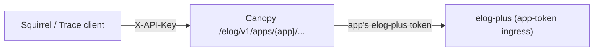

# E-log

The E-log module posts entries to an electronic logbook on behalf of Canopy's
client apps (Squirrel, Trace, ...). It is a server-side shim: Canopy holds one
e-log **application token per client app**, so no browser or desktop client
ever holds one. Clients call Canopy with their ordinary API key; Canopy calls
the e-log with the token of the app named in the URL.

The in-tree provider targets [elog-plus](https://github.com/slaclab/elog-plus),
SLAC's e-log backend. elog-plus records the app's token identity as the author
of every entry the app posts.



## Configuration

Environment variables use the prefix `CANOPY_ELOG__`, with `__` as the nested
delimiter. The app name in `APPS__<APP>__` is the `{app}` path segment of the
routes (env names are case-insensitive, so `APPS__SQUIRREL__` serves
`/elog/v1/apps/squirrel/...`).

| Variable | Default | Description |
|----------|---------|-------------|
| `CANOPY_ELOG__PROVIDER` | `""` (disabled) | `elog_plus`, or a `module:Class` dotted path to an out-of-tree adapter. |
| `CANOPY_ELOG__ELOG_PLUS__BASE_URL` | — | elog-plus' **application-token ingress**. SLAC production: `https://elog.example.org/api/elog-apptoken`. Not `/api/elog`: that path is behind Vouch, which strips the token header. |
| `CANOPY_ELOG__ELOG_PLUS__AUTH_HEADER` | `x-vouch-idp-accesstoken` | Header the token travels in; matches `ELOG_PLUS_AUTH_HEADER` on the elog-plus service. |
| `CANOPY_ELOG__APPS__<APP>__TOKEN` | — | The app's elog-plus application token. An app without one reports `enabled: false`. |
| `CANOPY_ELOG__APPS__<APP>__DEFAULT_LOGBOOK_IDS` | `[]` | JSON list of logbook ids the client preselects, e.g. `["<id>"]`. |
| `CANOPY_ELOG__PROXY_URL` | unset | Outbound HTTP(S) proxy for e-log calls. Process proxy variables (`HTTPS_PROXY`, ...) are ignored. |
| `CANOPY_ELOG__TIMEOUT_S` | `15` | Per-request timeout to the e-log, in seconds. |
| `CANOPY_ELOG__MAX_ATTACHMENT_BYTES` | `20971520` (20 MiB) | Larger attachment uploads are rejected with 413. |

```bash
CANOPY_ELOG__PROVIDER=elog_plus
CANOPY_ELOG__ELOG_PLUS__BASE_URL=https://elog.example.org/api/elog-apptoken
CANOPY_ELOG__APPS__SQUIRREL__TOKEN=<squirrel's elog-plus token>
CANOPY_ELOG__APPS__SQUIRREL__DEFAULT_LOGBOOK_IDS=["<logbook id>"]
CANOPY_ELOG__APPS__TRACE__TOKEN=<trace's elog-plus token>
```

A misconfigured provider (unknown name, missing base URL) leaves the module
disabled rather than failing Canopy's startup. The startup log says why, and
so does every app's `config` route (`reason`).

## Minting an elog-plus application token

Do this once per client app, per elog-plus instance:

1. Create the application, either in the elog-plus admin UI (**Applications**)
   or with `POST /v1/applications` as an elog-plus admin:

    ```bash
    curl -X POST "$ELOG_PLUS/v1/applications" -H "Content-Type: application/json" \
      -d '{"name": "canopy-squirrel", "owner": "<your email>", "expiration": "2027-12-31"}'
    ```

    The response payload is the application id. The token itself is in the
    application's details (`GET /v1/applications/{id}`, field `token`).

2. Grant the application **Write** on every logbook the app posts to (admin UI,
   or `POST /v1/authorizations` with `ownerType: "Token"`). Without it,
   posts fail with `502 elog_upstream_error` carrying elog-plus' 403.

3. Put the token in `CANOPY_ELOG__APPS__<APP>__TOKEN` and restart Canopy. Then
   check it with `GET /elog/v1/health/summary`: the app should be `healthy`,
   with the application's email as its `identity`.

Note the token's expiration date: an expired token shows up as an unhealthy
app in the health summary.

## Routes

All routes live under `/elog/v1`. API keys need the module scope `elog`
(for example `<token>:read+write@squirrel+elog`); see
[API keys](../deployment/api-keys.md#module-scoping).

| Method and path | Access | Returns |
|-----------------|--------|---------|
| `GET /apps/{app}/config` | none | `{enabled, provider, defaultLogbookIds, reason}` |
| `GET /apps/{app}/logbooks` | read | `[{id, name}]` |
| `GET /apps/{app}/logbooks/{logbookId}/tags` | read | `[{id, name}]` |
| `GET /apps/{app}/users?search=&limit=20` | read | `[{uid, commonName, surname, gecos, mail}]` (`search` 1–100 chars, `limit` 1–100) |
| `GET /apps/{app}/recent-entries?logbookId=a&logbookId=b&limit=5` | read | `[{id, title, loggedAt, loggedBy}]`, entries this app's token posted (`limit` 1–20) |
| `POST /apps/{app}/attachments` | write | `{id}`; multipart with one part named `file` |
| `POST /apps/{app}/entries` | write | `{id, url}` |
| `GET /health/watchdog` | none | liveness heartbeat |
| `GET /health/summary` | read | `{status, provider, apps: [{app, healthy, identity, latencyMs, lastError}]}` |

`{app}` must match `^[a-z0-9_-]{1,64}$` (the same rule as Magpie's app names).

`config` answers 200 for any well-formed app name, so a client can call it
unauthenticated and hide its "Post to e-log" button when `enabled` is false.

### Posting an entry

```json
{
  "logbookIds": ["<logbook id>"],
  "title": "Snapshot: injector",
  "bodyMarkdown": "Saved **before** the energy change.",
  "tagIds": ["<tag id>"],
  "attachmentIds": ["<id from POST /attachments>"],
  "additionalAuthors": ["jdoe@example.org"],
  "important": false,
  "eventAt": "2026-10-20T17:00:00Z",
  "followsUpEntryId": null
}
```

- `bodyMarkdown` is rendered to HTML by Canopy: elog-plus stores entry text
  as HTML and does not process markdown.
- There is no author field. elog-plus credits the app's token;
  `additionalAuthors` adds people, and elog-plus rejects the **whole** post if
  any of them is not an email it knows (look them up with `/users` first).
- `eventAt` with an offset is converted to UTC; a value without one is taken as
  UTC already. `loggedAt` in `recent-entries` is always UTC with an offset.
- `followsUpEntryId` set means the entry is posted as a follow-up of that entry.
- `url` is `null` for now.
- To attach files, upload each with `POST /attachments` first and pass the
  returned ids in `attachmentIds`.

Canopy logs one line per post (app, API key name, logbook ids, follow-up
parent, new entry id), never the token or the body.

### Errors

| Status | `code` | When |
|--------|--------|------|
| 400 | `invalid_app_name` | `{app}` breaks the app-name rule |
| 404 | `elog_app_not_found` | `{app}` has no token configured |
| 413 | `elog_attachment_too_large` | upload over `MAX_ATTACHMENT_BYTES` |
| 501 | `elog_not_supported` | the provider has no equivalent (an out-of-tree adapter without follow-ups, say) |
| 502 | `elog_upstream_error` | the e-log rejected the call or is unreachable; `detail` carries its status and message |
| 503 | `elog_not_configured` | no usable provider on this instance |
| 504 | `elog_upstream_timeout` | the e-log did not answer within `TIMEOUT_S` |

Plus the standard `invalid_api_key` (401), `insufficient_module_access`,
`insufficient_read_access`, `insufficient_write_access` (403), and 422 for a
malformed request.

### Health summary

`status` is `disabled` when no app can post (no provider, or no app has a
token), otherwise `ok` when every app's token probe succeeds, `down` when none
does, and `degraded` in between. Each app is probed concurrently with
`GET /v1/users/me` on elog-plus, two seconds per probe.

## Calling it in-process

Other Canopy modules post through `canopy.elog.gateway` (`create_entry`,
`upload_attachment`, `app_config`), naming the app they post as. The entry is
credited to that app's token exactly as an HTTP post would be.
