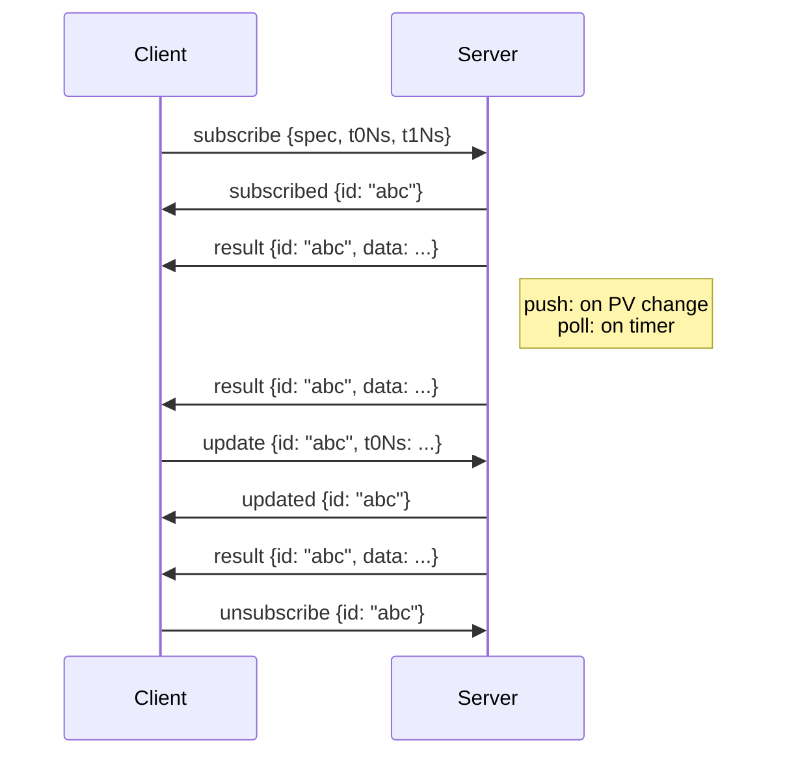

# Fox WebSocket subscriptions

The Fox WebSocket endpoint provides live formula evaluation streams. Clients subscribe to formulas and receive results in real-time as underlying PV data changes.

## Connecting

```
ws://<host>/fox/v1/ws/formulas
```

Authentication is required via the `X-API-Key` header (or query parameter, depending on your WebSocket client). The key must have the `read` scope.

After connecting, the server accepts JSON messages and responds with JSON messages. Each message has a `type` field that identifies its purpose.

## Client --> server messages

### subscribe

Open a new formula subscription.

```json
{
  "type": "subscribe",
  "spec": {
    "kind": "timeseries",
    "expression": "{a} + {b}",
    "bindings": {
      "a": "PV:SENSOR:A",
      "b": "PV:SENSOR:B"
    },
    "align": "last",
    "index": "union"
  },
  "t0Ns": -60000000000,
  "t1Ns": 0,
  "intervalMs": 0
}
```

| Field | Type | Required | Description |
|-------|------|----------|-------------|
| `spec` | FormulaSpec | yes | Formula specification (same as REST API) |
| `t0Ns` | int | no | Window start — negative values are relative to now (default: `0`) |
| `t1Ns` | int | no | Window end — `0` means "now" / live (default: `0`) |
| `intervalMs` | int | no | Poll interval in milliseconds (default: `0` = push mode) |

### unsubscribe

Cancel a subscription by its server-assigned ID.

```json
{
  "type": "unsubscribe",
  "id": "a1b2c3d4e5f6"
}
```

### update

Modify a subscription's parameters without unsubscribing and resubscribing. Any fields not provided retain their current values.

```json
{
  "type": "update",
  "id": "a1b2c3d4e5f6",
  "spec": {
    "kind": "timeseries",
    "expression": "{a} - {b}",
    "bindings": {
      "a": "PV:A",
      "b": "PV:B"
    }
  },
  "t0Ns": -120000000000,
  "intervalMs": 5000
}
```

| Field | Type | Required | Description |
|-------|------|----------|-------------|
| `id` | string | yes | Subscription ID to update |
| `spec` | FormulaSpec | no | New formula spec |
| `t0Ns` | int | no | New window start |
| `intervalMs` | int | no | New poll interval |

### ping

Keep-alive message. The server responds with `pong`.

```json
{
  "type": "ping"
}
```

## Server --> client messages

### subscribed

Confirms a subscription was created and provides the assigned ID.

```json
{
  "type": "subscribed",
  "id": "a1b2c3d4e5f6"
}
```

### result

A new evaluation result for a subscription. The `data` field contains the same result shape as the REST evaluate endpoint (discriminated by `kind`).

```json
{
  "type": "result",
  "id": "a1b2c3d4e5f6",
  "data": {
    "kind": "timeseries",
    "tsNs": [
      1700000000000000000,
      1700000001000000000
    ],
    "values": [
      3.5,
      4.2
    ],
    "severity": [
      "NO_ALARM",
      "NO_ALARM"
    ],
    "inputs": {
      "a": "PV:SENSOR:A",
      "b": "PV:SENSOR:B"
    },
    "decimated": false
  }
}
```

### updated

Confirms a subscription was updated successfully.

```json
{
  "type": "updated",
  "id": "a1b2c3d4e5f6"
}
```

### completed

Sent after a one-shot evaluation finishes. The subscription is automatically removed — no `unsubscribe` needed.

```json
{
  "type": "completed",
  "id": "a1b2c3d4e5f6"
}
```

### error

An error occurred for a specific subscription or for the connection.

```json
{
  "type": "error",
  "id": "a1b2c3d4e5f6",
  "code": "formula_input_missing",
  "message": "PV:SENSOR:A has no buffered data"
}
```

The `id` field is present when the error is specific to a subscription. Connection-level errors (e.g., unknown message type) omit it.

### pong

Response to a `ping` message with the server timestamp.

```json
{
  "type": "pong",
  "timestamp": 1700003600.123
}
```

## Subscription modes

The combination of `t0Ns`, `t1Ns`, and `intervalMs` determines how the subscription behaves:

### Push mode (default)

```json
{
  "t0Ns": -60000000000,
  "t1Ns": 0,
  "intervalMs": 0
}
```

The formula re-evaluates immediately whenever any of its input PVs receive new data from Vole. This provides the lowest-latency updates. The time window slides forward with each evaluation — `t0Ns` as a negative value means "N nanoseconds before now."

### Poll mode

```json
{
  "t0Ns": -60000000000,
  "t1Ns": 0,
  "intervalMs": 5000
}
```

The formula re-evaluates on a fixed timer (every `intervalMs` milliseconds) regardless of whether input data has changed. Use this when you want a predictable update cadence rather than per-sample updates.

### One-shot mode

```json
{
  "t0Ns": 1700000000000000000,
  "t1Ns": 1700003600000000000
}
```

When `t1Ns` is non-zero (a fixed historical endpoint), the formula evaluates once over the specified window, sends the result, and then sends a `completed` message. The subscription is automatically cleaned up — no `unsubscribe` needed.

This is equivalent to the REST `/evaluate` endpoint but over the WebSocket connection, useful for batch queries without opening separate HTTP requests.

## Subscription lifecycle



## Shared evaluation

Multiple clients subscribing to the same formula with identical parameters (`spec`, `t0Ns`, `intervalMs`) share a single evaluation loop. Results are fanned out to all listeners. This deduplicates computation when many clients watch the same formula.

When a subscription is updated, the listener is moved to a new shared eval (or an existing one with matching parameters). Other listeners on the old shared eval are unaffected.

## Error handling

- **Per-subscription errors** include the subscription `id` and describe issues with that specific formula (parse errors, missing PVs, timeouts).
- **Connection-level errors** omit the `id` field and indicate protocol issues (unknown message type, malformed spec).
- **Retriable errors** (missing inputs, PV not yet buffered) are automatically retried with a short delay. The client does not need to resubscribe.
- **On disconnect**, all client subscriptions are automatically cleaned up.
