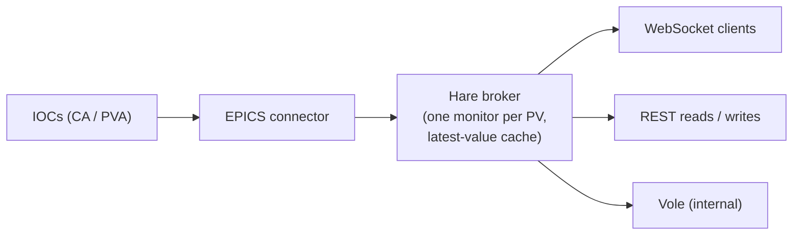

# Hare live-PV broker

Hare is Canopy's gateway to live EPICS data. It brokers Process Variable (PV)
values between the control system and any number of clients: a WebSocket
stream for continuous updates, and REST endpoints for one-shot reads, display
metadata, and writes.

## How it works

Hare keeps **one EPICS monitor per PV**, no matter how many clients subscribe
to it. Updates land in a cache of latest values and are fanned out to
subscribers as batched diffs. New subscribers get the current value
immediately from the cache — no extra load on the IOC.

## Values and metadata

A PV's data is split into two payloads, matching how EPICS itself separates
them:

- **`PVValue`** — the dynamic part that changes on every update: `value`,
  alarm `severity`, timestamp (`tsNs`), `connected`. This is what streams
  over the WebSocket and what `GET /pvs/{pv}` returns.
- **`PVMeta`** — static per-channel metadata a client reads once to configure
  a display: units, precision, enum choice labels, display/control/alarm
  limits, writability. Served by `GET /pvs/{pv}/describe` and included in the
  WebSocket `initial` frame.

Every value carries a `valueKind` discriminator telling the client how to
interpret it:

| `valueKind` | `value` payload |
|-------------|-----------------|
| `scalar` | Number or boolean |
| `string` | String |
| `enum` | Integer choice index — labels come from `enumChoices` in the metadata |
| `waveform` | 1-D array of numbers, or of strings for a string waveform |
| `table` | `{labels, columns}` object (PV Access NTTable, column-major) |
| `image` | Reserved — images will travel as binary frames, not JSON |
| `unsupported` | A recognized but not-yet-rendered Normative Type |

## PV names

- Unprefixed names (`TEST:SINE`) use **Channel Access**. Prefix with
  `pva://` for **PV Access** (`pva://TEST:COUNTER`); an explicit `ca://` is
  also accepted. Prefixes are case-insensitive.
- Names are validated at every entry point: empty names, names over 255
  characters, and names containing whitespace or control characters are
  rejected with `400 invalid_pv_name` before they reach the EPICS libraries.

## Backends

The EPICS connector behind Hare has two backends, selected with
`CANOPY_EPICS__BACKEND`:

- **`simulation`** (default) — every PV name resolves to a synthetic sine
  wave. No IOC or network needed; ideal for frontend development and CI.
  The name's suffix picks the value kind: `:ENUM`, `:WAVEFORM` / `:WF`,
  `:STR_WAVEFORM` / `:STR_WF` (string waveform), `:STR`, `:TABLE`; anything
  else is a scalar.
- **`epics`** — real Channel Access / PV Access via the facility network.
  Discovery uses the standard EPICS environment variables
  (`EPICS_CA_ADDR_LIST`, `EPICS_PVA_ADDR_LIST`, ...).

## Configuration

Environment variables with prefix `CANOPY_HARE__`:

| Variable | Default | Meaning |
|----------|---------|---------|
| `CANOPY_HARE__WS_BATCH_INTERVAL_MS` | `100` | Diff-stream batching window — buffered updates flush to clients this often |
| `CANOPY_HARE__HEARTBEAT_INTERVAL_S` | `5.0` | Cadence of WebSocket `heartbeat` frames |
| `CANOPY_HARE__MAX_PVS_PER_MESSAGE` | `5000` | Max PV names accepted in a single subscribe frame (excess dropped) |
| `CANOPY_HARE__MAX_SUBSCRIPTIONS_PER_CLIENT` | `20000` | Max distinct PVs one client may hold subscriptions to |
| `CANOPY_HARE__EVENT_QUEUE_MAXSIZE` | `100000` | Bound on the internal update queue (overflow drops newest + warns) |
| `CANOPY_HARE__SEED_CONCURRENCY` | `32` | Max concurrent reads when seeding a fresh subscribe batch |

The connector's own settings use the `CANOPY_EPICS__` prefix — see
`.env.example` at the repo root for the full annotated list.

## In this guide

- [REST API](rest_api.md) — one-shot reads, display metadata, writes.
- [WebSocket stream](websocket.md) — the subscribe/diff protocol.
