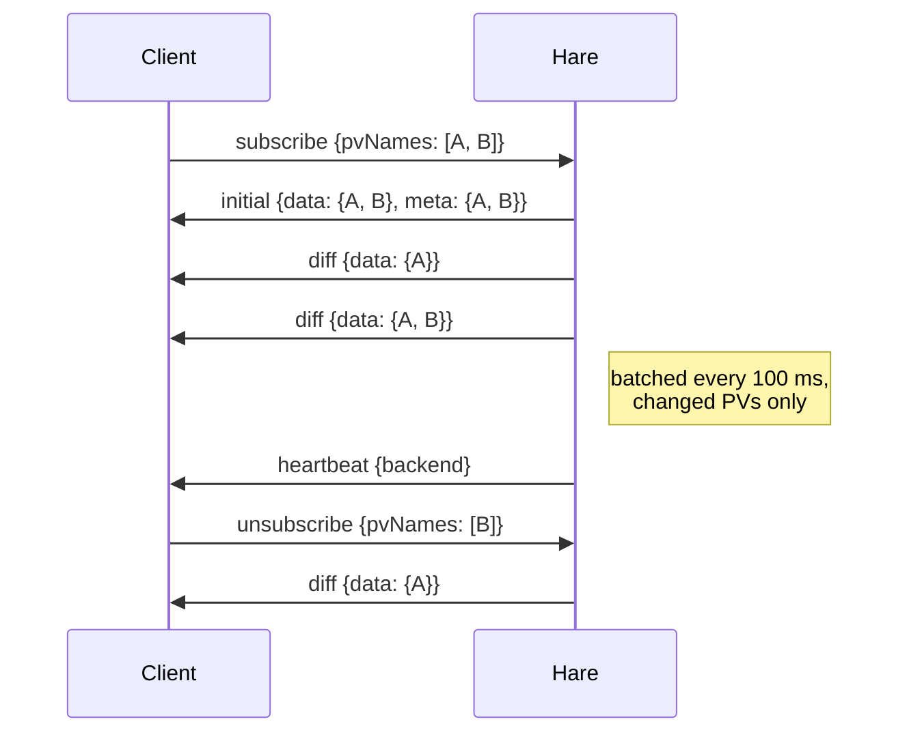

# Hare WebSocket stream

The Hare WebSocket endpoint streams live PV updates. Clients subscribe to sets
of PVs and receive an initial snapshot (values + display metadata) followed by
batched diffs as values change.

## Connecting

**Endpoint:**

```
ws://<host>/hare/v1/ws/pvs
```

Use `wss://` in production (TLS).

### Authentication

The API key (with `read` scope) can be provided in two ways:

1. **Header** (preferred) — set `X-API-Key` during the handshake
2. **Query parameter** — append `?api_key=<token>` to the URL, for clients
   (e.g. the browser `WebSocket` API) that cannot set custom headers

If authentication fails, the server closes the connection with WebSocket
status code `1008` (Policy Violation).

### Example — JavaScript

```javascript
const ws = new WebSocket("ws://localhost:8000/hare/v1/ws/pvs?api_key=your-api-key");

ws.onopen = () => {
  ws.send(JSON.stringify({
    type: "subscribe",
    pvNames: ["TEST:SINE", "pva://TEST:COUNTER"]
  }));
};

ws.onmessage = (event) => {
  const msg = JSON.parse(event.data);
  if (msg.type === "diff") {
    for (const [pv, value] of Object.entries(msg.data)) {
      console.log(pv, value.value, value.severity);
    }
  }
};
```

### Example — Python (websockets)

```python
import asyncio
import json
import websockets

async def main():
    uri = "ws://localhost:8000/hare/v1/ws/pvs"
    headers = {"X-API-Key": "your-api-key"}

    async with websockets.connect(uri, additional_headers=headers) as ws:
        await ws.send(json.dumps({
            "type": "subscribe",
            "pvNames": ["TEST:SINE", "TEST:WAVEFORM"],
        }))
        async for raw in ws:
            msg = json.loads(raw)
            print(msg["type"], msg)

asyncio.run(main())
```

## Client --> server messages

### subscribe

```json
{
  "type": "subscribe",
  "pvNames": ["TEST:SINE", "pva://TEST:COUNTER"]
}
```

`pvNames` must be a list of strings. Subscribing is idempotent — names the
client already holds are accepted again at no cost. Invalid names in the batch
are rejected individually (see [error frames](#error) below); the valid names
still subscribe.

### unsubscribe

```json
{
  "type": "unsubscribe",
  "pvNames": ["TEST:SINE"]
}
```

### ping

```json
{
  "type": "ping"
}
```

The server responds with `pong`.

## Server --> client messages

### initial

Sent after a `subscribe`, once the new PVs have been seeded. `data` maps PV
name to its current value; `meta` maps PV name to its static display metadata
(units, precision, `enumChoices`, limits) — read `meta` once, then rely on
diffs for the values.

```json
{
  "type": "initial",
  "data": {
    "TEST:SINE": {
      "pv": "TEST:SINE",
      "value": 3.27,
      "valueKind": "scalar",
      "severity": "NO_ALARM",
      "alarmStatus": 0,
      "tsNs": 1700000000123456789,
      "connected": true,
      "error": null
    }
  },
  "meta": {
    "TEST:SINE": {
      "pv": "TEST:SINE",
      "valueKind": "scalar",
      "units": "degC",
      "precision": 2,
      "displayLow": -10.0,
      "displayHigh": 10.0,
      "writable": true
    }
  },
  "count": 1
}
```

A PV that is valid but has not produced a value yet (e.g. a disconnected
channel) may be absent from `initial` — its first `diff` arrives when the
channel connects. If no PV in the batch yields a value or metadata, the
`initial` frame is skipped entirely, so do not treat it as a subscribe
acknowledgement.

### diff

The workhorse frame. Updates are buffered and flushed on a fixed cadence
(`CANOPY_HARE__WS_BATCH_INTERVAL_MS`, default 100 ms); each flush carries only
the PVs whose values changed since the last one, and only the dynamic
`PVValue` payload — metadata is never re-sent.

```json
{
  "type": "diff",
  "data": {
    "TEST:SINE": {
      "pv": "TEST:SINE",
      "value": 3.31,
      "valueKind": "scalar",
      "severity": "NO_ALARM",
      "alarmStatus": 0,
      "tsNs": 1700000000223456789,
      "connected": true,
      "error": null
    }
  },
  "count": 1,
  "timestamp": 1700000000.25
}
```

`value` is a number, a string, an enum index, a 1-D array, or a
`{labels, columns}` table, per `valueKind` — see
[values and metadata](index.md#values-and-metadata). `alarmStatus` is the EPICS
`menuAlarmStat` code behind `severity` (see the
[value fields](rest_api.md#get-harev1pvspv)).

### heartbeat

Sent every `CANOPY_HARE__HEARTBEAT_INTERVAL_S` seconds (default 5) so clients
know the broker is alive even when no values are changing.

```json
{
  "type": "heartbeat",
  "timestamp": 1700000005.0,
  "backend": "simulation"
}
```

`backend` names the active EPICS backend — a frontend can surface a warning
when it is unexpectedly `simulation`.

### pong

```json
{
  "type": "pong",
  "timestamp": 1700000000.5
}
```

### error

Errors arrive as frames on the open connection — **a bad message never drops
the socket** (only an authentication failure closes it).

A malformed frame (invalid JSON, unknown `type`, `pvNames` not a list of
strings) produces:

```json
{
  "type": "error",
  "code": "invalid_message",
  "message": "pvNames: Input should be a valid list"
}
```

A `subscribe` containing malformed PV names produces an error frame listing
exactly which names were rejected — the rest of the batch subscribes
normally:

```json
{
  "type": "error",
  "code": "invalid_pv_name",
  "message": "rejected 2 invalid PV name(s)",
  "pvNames": ["", "BAD NAME"]
}
```

This lets a client distinguish "rejected at subscribe time" from "valid PV
that has not produced a value yet."

## Lifecycle



On disconnect, all of the client's subscriptions are cleaned up
automatically; monitors for PVs no other client watches are released.

## Limits

The broker enforces per-client caps (configurable — see
[configuration](index.md#configuration)):

| Cap | Default | Behavior at the limit |
|-----|---------|-----------------------|
| PVs per subscribe message | 5000 | Excess names in the frame are dropped |
| Subscriptions per client | 20000 | New PVs beyond the budget are dropped; existing ones unaffected |

Dropped names are logged server-side but do **not** produce an error frame —
stay under the caps by batching subscriptions sensibly. Re-subscribing to
already-held PVs never counts against the budget.
