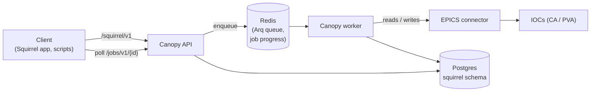

# Squirrel snapshots

Squirrel saves, restores, and compares machine state. A **snapshot** records
the value of every PV Squirrel tracks at one moment; a **restore** writes a
snapshot's saved setpoints back to the control system. Squirrel is the backend
for the [Squirrel app](https://slaclab.github.io/react-squirrel/), and any
client with an API key can use it directly.

## Concepts

- **PV** — one entry Squirrel tracks, made up of up to three EPICS addresses:
    - a **setpoint**, which is captured and restored,
    - a **readback**, which is captured but never restored, and
    - a **config** address, which is stored for reference but neither
      captured nor restored.

    A PV needs at least one address. Only the setpoint address must be
    unique; PVs can share a readback. A PV with a readback but no setpoint is
    **readback-only**: it appears in snapshots but is never written.
- **Device and description** — optional labels for searching and display.
- **Tolerances** — each PV's absolute and relative tolerance, used when
  comparing two values (see [Comparing snapshots](#comparing-snapshots)).
- **Tag groups and tags** — named groups (`Area`, `Subsystem`, ...) of tags
  that you attach to PVs to filter them. A PV can carry tags from any number
  of groups.
- **Snapshot** — a title, an optional description, the capture time, and one
  saved value per PV. Each saved value keeps the setpoint and readback
  readings with their alarm status, severity, and timestamp.
- **Meta PV** — a PV whose saved value is shown alongside every snapshot in a
  list, such as beam energy, so users can tell snapshots apart at a glance.
  Promoting a PV to a meta PV gives it a short display name; a meta PV can be
  deactivated to hide it without losing that name.

## How it works

Capturing or restoring thousands of PVs takes longer than an HTTP request
should, so both run as **background jobs**. The API enqueues the job and
returns a job id at once; the Canopy worker does the EPICS reads or writes and
reports progress, which the client polls through the [Jobs](../modules/index.md)
module.



Everything else (listing, searching, editing PVs and tags, comparing) runs
directly in the API against Postgres. Squirrel talks to EPICS through
Canopy's shared connector, not through Hare, so it is unaffected by live
subscriptions. With the default `simulation` backend, every PV reads as a
synthetic value and writes always succeed unless configured to fail (see
[Configuration](configuration.md)).

## Capturing a snapshot

1. `POST /squirrel/v1/snapshots` with a title and optional description
   returns `{jobId, statusUrl}`.
2. The worker reads every tracked PV's setpoint and readback address. Each
   address is read once, even if several PVs share it, with up to
   `CANOPY_SQUIRREL__EPICS_CONCURRENCY` reads in flight.
3. A read that fails or times out does not fail the snapshot: that address is
   simply not saved. A PV whose setpoint and readback both failed is saved
   with no values.
4. The snapshot and all its values are written in a single transaction, so a
   snapshot is either saved complete or not at all.
5. The finished job's `result` is `{"type": "snapshot", "id": "<snapshot id>"}`.

## Restoring a snapshot

1. `POST /squirrel/v1/snapshots/{id}/restore` returns `{jobId, statusUrl}`.
   An optional body `{"pvIds": [...]}` limits the restore to those PVs;
   without it the whole snapshot is restored.
2. The worker builds the **write set**: the saved setpoint of each PV that has
   a setpoint address and a saved setpoint value. Readbacks are never
   written, and readback-only PVs are skipped.
3. Any configured [restore hooks](restore_hooks.md) work out their extra
   writes for the whole write set before anything is written.
4. The setpoints are written as one batch, then each hook's extra writes
   follow as their own batch, in the configured order.
5. The job reports progress per **phase**: `Setpoints`, then one phase per
   hook, named after the hook's class (`WriteToConHook`, `MagnetTrimHook`).
6. The finished job's `result` summarizes the restore:

    ```json
    {
      "type": "restore",
      "snapshotId": "8d0c3f9e-...",
      "totalPvs": 1250,
      "successCount": 1248,
      "failureCount": 2,
      "failures": [
        {
          "pvId": "41a7...",
          "pvName": "QUAD:LI21:201:BDES",
          "error": "simulated put failure for QUAD:LI21:201:BDES",
          "phase": "Setpoints"
        }
      ]
    }
    ```

    `failures` lists at most 50 PVs; `failureCount` is the full count. A
    failure's `phase` says which batch failed for that PV.

A restore only writes to EPICS; it never changes the database.

!!! warning "A restore writes to the live machine"
    With `CANOPY_EPICS__BACKEND=epics`, a restore puts values to real IOCs
    as soon as the worker picks up the job. Issue `write`-scoped keys only to
    clients that should be able to do this.

## Comparing snapshots

`GET /squirrel/v1/snapshots/{id1}/compare/{id2}` compares two snapshots PV by
PV and returns the differences inline, with no job. Two values match when:

- their difference is at most the PV's **absolute tolerance**, or
- the PV has a **relative tolerance** above zero and the difference, divided
  by the first snapshot's value, is at most that tolerance.

Waveforms are compared element by element under the same rule; waveforms of
different lengths never match. Non-numeric values must be equal. A PV
present in only one of the snapshots counts as a difference.

Comparison loads both snapshots into memory, so comparing two very large
snapshots is a sizeable request.

## Before you start

- **Migrations.** Squirrel's tables live in the `squirrel` Postgres schema,
  which is created by `uv run alembic upgrade head`. Squirrel endpoints return
  errors until it has run (see [Docker Compose](../deployment/docker.md)).
- **A running worker.** Without one, capture and restore jobs stay `pending`
  forever. The development and production Compose stacks both start one.
- **An API key scoped to Squirrel.** Reads need `read`, and anything that
  changes data (including capture and restore) needs `write`. The key must
  include the `squirrel` module, as in `token:read+write@squirrel`; a key's
  access to Jobs is implicit. See [API keys](../deployment/api-keys.md).

## In this guide

- [REST API](rest_api.md) — every Squirrel endpoint, plus job polling.
- [Configuration](configuration.md) — `CANOPY_SQUIRREL__*` and related
  settings.
- [Restore hooks](restore_hooks.md) — extra writes Squirrel makes during a
  restore, and how to configure them.
- [Testing](testing.md) — running Squirrel's tests and simulating EPICS for
  development.
