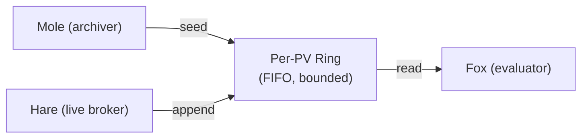

# Vole data buffer

Vole is an in-memory time-series data buffer that sits between Hare (live PV data broker) and Fox (formula evaluator). It maintains per-PV ring buffers that combine live data from Hare with historical data seeded from Mole, providing Fox with a unified, low-latency data layer for formula evaluation.

## How it works

Each PV gets its own **ring buffer** — a fixed-capacity FIFO queue of timestamped samples. When the buffer is full, the oldest samples are dropped to make room for new ones.



Key properties:

- **Per-PV capacity**: Each ring holds up to `max_points` samples (default: 500,000)
- **Global memory ceiling**: Total memory across all rings is bounded (default: 4 GB)
- **LRU eviction**: When the global ceiling is reached, entire rings are evicted starting with the least-recently-accessed PV
- **~80 bytes per sample**: Memory estimation for capacity planning

## Auto-provisioning

When Fox evaluates a formula referencing a PV that Vole doesn't have buffered, Vole automatically provisions it:

1. **Seed** — Fetches historical data from Mole for the requested time window and loads it into a new ring buffer
2. **Subscribe** — Registers with Hare for live updates so future samples arrive automatically
3. **Serve** — The PV is now available for all subsequent formula evaluations

This happens transparently on first access. Subsequent evaluations read directly from the in-memory buffer with no network round-trips.

## Data lifecycle

### Live vs. archive samples

Every sample in Vole is tagged with its source:

- **`live`** — Received from Hare in real-time
- **`archive`** — Seeded from Mole historical data

When both sources provide a sample at the same timestamp, the live sample wins.

### Ordering rules

Vole enforces strict time ordering within each ring:

- Samples must arrive in monotonically increasing timestamp order
- Out-of-order samples are rejected (not added to the buffer)
- Archive samples with timestamps at or after the earliest live sample are skipped during seeding

This guarantees that the ring's contents are always sorted, enabling efficient time-window queries.

### Buffer lifecycle

- **Created** on first access (via auto-provisioning, explicit seed, or client subscribe)
- **Appended** as live data flows from Hare
- **Read** by Fox for formula evaluation (updates LRU access time)
- **Grace period** — when all external subscribers disconnect, a configurable timer starts (default: 60s); resubscription cancels it
- **Dropped** when the grace period expires without reconnection, or explicitly via the gateway
- **Evicted** when global memory pressure requires it (LRU, entire ring removed)

## Client-initiated subscriptions

In addition to auto-provisioning (triggered by Fox formula evaluation), clients can explicitly subscribe PVs via the REST API:

```
POST /vole/v1/pvs/subscribe          # body: {"pvs": ["PV:A", "PV:B"]}
POST /vole/v1/pvs/subscribe/{pv}     # single PV by path
```

This is useful for dashboards or batch readers that want pre-warmed buffers without maintaining a Hare WebSocket connection. See the [REST API docs](rest_api.md#subscribe-multi-pv) for full details.

### Grace period

When the last external Hare subscriber disconnects from a PV, Vole doesn't drop the buffer immediately. Instead, a **grace period** starts (configurable via `CANOPY_VOLE__BUFFER_GRACE_SECONDS`, default 60s). If a subscriber reconnects before the timer fires, the buffer stays warm. Otherwise, Vole unsubscribes from Hare and drops the ring.

This tolerates page refreshes, brief network blips, and tab switches without losing buffered data.

## Change notifications

Vole provides a push-based notification system that Fox uses for live formula subscriptions. When a ring buffer receives a new sample, Vole fires registered callbacks for that PV. This triggers Fox to re-evaluate any formulas that reference that PV — providing low-latency updates without polling.

Callbacks are fire-and-forget: exceptions in a callback are logged but don't affect the data path or other callbacks.

## Memory model

| Parameter | Default | Env var |
|-----------|---------|---------|
| Per-PV ring capacity | 500,000 samples | `CANOPY_VOLE__MAX_POINTS` |
| Global memory ceiling | 4 GB | `CANOPY_VOLE__GLOBAL_BYTES_MAX` |
| Estimated per-sample size | ~80 bytes | (fixed) |

With defaults, Vole can buffer approximately 100 PVs at full capacity (500k samples x 80 bytes = ~40 MB each, 100 PVs = ~4 GB).

When the global ceiling is exceeded:

1. Rings are sorted by last access time (oldest first)
2. Entire rings are evicted until total memory drops below the ceiling
3. Evicted PVs are unsubscribed from Hare
4. If a formula later references an evicted PV, auto-provisioning re-creates it

See [Configuration](configuration.md) for tuning these parameters.
